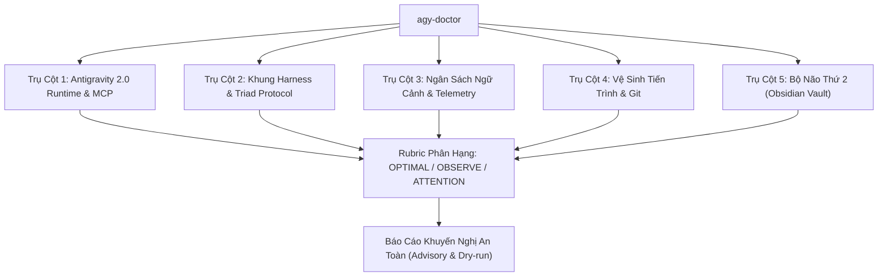

# Kỹ Năng: Antigravity 2.0 Doctor (`agy-doctor`)

## 1. Tổng Quan & Tuyên Ngôn Bất Biến

> [!IMPORTANT]
> **Nguyên Tắc Bất Biến (100% Read-Only & Non-Destructive):**
> Kỹ năng `agy-doctor` vận hành thuần túy ở chế độ chẩn đoán, đo đạc, phát hiện nguy cơ và xuất khuyến nghị hành động (**Advisory-Only**).
> TUYỆT ĐỐI KHÔNG tự động xóa file, không sửa file cấu hình, không thay đổi mã nguồn, và không cắt gọt bất kỳ file quy chuẩn nào của khung harness. Mọi hành động can thiệp đều phải có sự phê duyệt tường minh từ Sếp.

Kỹ năng `agy-doctor` đóng vai trò là "Bác sĩ Nội Trú Độc Lập" cho môi trường Antigravity 2.0 và Khung Harness Hub, giúp bảo vệ tính ổn định toàn diện của hệ thống qua **5 Trụ Cột Chẩn Đoán**.



---

## 2. 5 Trụ Cột Chẩn Đoán Của Antigravity Doctor

### Trụ Cột 1: Antigravity 2.0 Runtime & MCP (Giao Thức Tác Tử & Công Cụ Ngoại Vi)
1. **MCP Configuration (`mcp_config.json`):**
   - Rà soát vị trí cấu hình MCP của người dùng (`~/.gemini/antigravity/mcp_config.json` hoặc đường dẫn hệ thống tương ứng).
   - Kiểm tra tính hợp lệ của JSON, số lượng MCP Servers đã khai báo, trạng thái schemas công cụ.
2. **Kho Lưu Trữ Brain Storage:**
   - Kiểm tra thư mục lưu trữ hội thoại và artifacts (`brain/` trong App Data hoặc workspace).
   - Đo đạc dung lượng tổng thể, số lượng thư mục phiên, phát hiện tràn bộ nhớ tạm thời.
3. **Thứ Bậc Scaffolding & Context Budget Economics:**
   - Đối soát thứ bậc ưu tiên: `Skill (On-demand)` ➔ `Script (Deterministic)` ➔ `SubAgent (Large in, small out)` ➔ `Plugin/Hook (In-the-loop)` ➔ `Always-on text` cuối cùng.
   - Rà soát nguy cơ nạp kép (Double-Loading Hazard) tại `.agents/skills.json` (bắt buộc rỗng `{"entries": []}`).

### Trụ Cột 2: Khung Harness & Triad Protocol (Cơ Chế Bộ Ba & Trần Quy Chuẩn)
1. **Trần Ngân Sách Quy Chuẩn Rules:**
   - `GEMINI.md`: Khóa cứng trần ngân sách `<= 24KB` (24,576 bytes).
   - `configs/global_gemini.md` (nếu có): Khóa cứng trần ngân sách `<= 8KB` (8,192 bytes).
2. **Cầu Dao Ngắt Mạch Bộ Ba Tác Tử (Decoupled Circuit Breakers):**
   - Xác thực cấu hình `critic_rounds <= 2`, `qa_rounds <= 2`, `total_cycles <= 3`.
   - Ngăn chặn tình trạng loop vô hạn giữa Maker, Critic và QA Auditor.
3. **Tính Toàn Vẹn Của Harness & Test Suite:**
   - Kiểm tra sự tồn tại của các module cốt lõi (`harness/app_workflow.py`, `harness/orchestrator.py`, `tests/`).
   - Đảm bảo cơ chế Maker-Checker và các bài kiểm tra chất lượng không bị cắt xén.
4. **Đối Soát Trùng Lặp Quy Tắc Đa Tầng (Cross-Scope Rule Duplication Guard):**
   - Rà soát tệp quy chuẩn giữa Global Scope (`~/.gemini/config/GEMINI.md`) và Workspace Scope (`GEMINI.md`).
   - Kích hoạt cảnh báo 🔴 **ATTENTION: `ERR_DUPLICATE_RULES_ACROSS_SCOPES`** khi phát hiện trùng lặp quy tắc (>70% hoặc cùng chứa nội dung quy chuẩn), định lượng rõ lượng token/bytes context bị lãng phí (~7,000 tokens).
   - Hỗ trợ cờ `--fix-duplicate-rules` an toàn: Tự động sao lưu bản cũ thành `.bak_<timestamp>` và tinh gọn Global GEMINI.md thành bản tối giản chuẩn toàn cục (< 1,500 tokens).

### Trụ Cột 3: Ngân Sách Ngữ Cảnh & Telemetry (Chống Mờ Ngữ Cảnh & Tràn Token)
1. **Đo Đạc Phiên Làm Việc Thực Tế:**
   - Tự động nhận diện file transcript hoạt động (`transcript.jsonl`) trong thư mục `.system_generated/logs/` hoặc môi trường.
   - Đo tổng số byte và số lượt tương tác (user turns & steps).
2. **Phân Vùng Ngưỡng Cảnh Báo (Telemetry Levels):**
   - **🟢 GREEN (Tối ưu):** Dung lượng `<= 200KB` và `<= 35 turns`. Trạng thái an toàn tuyệt đối.
   - **🟡 YELLOW (Cảnh báo sớm):** Dung lượng `> 200KB` hoặc `> 35 turns`. Khuyến nghị Sếp gõ `/compact` hoặc chuẩn bị kết thúc phiên.
   - **🔴 RED (Ngắt mạch bắt buộc):** Dung lượng `> 250KB` hoặc `> 40 turns`. Nguy cơ suy giảm trí nhớ nghiêm trọng, kích hoạt Session Rollover tự động.

### Trụ Cột 4: Vệ Sinh Tiến Trình & Git (Process & Storage Hygiene)
1. **Phát Hiện File Khóa Mồ Côi (Stuck Git/Brain Locks):**
   - Quét `.git/index.lock`, `.git/refs/heads/*.lock`, hoặc file `*.lock` tồn tại trong workspace và `.brain/`.
   - Cảnh báo các file khóa có tuổi thọ lớn hơn 30 phút gây nghẽn lệnh git và task ngầm.
2. **Khảo Sát Tiến Trình Mồ Côi Trên Windows:**
   - Rà soát các tiến trình trình duyệt tự động hóa (`chrome-headless-shell.exe`, các instance `chrome.exe`/`msedge.exe` có cờ `--headless` hoặc `--remote-debugging-port`).
   - Rà soát tiến trình Office/COM treo modal ngầm (`WINWORD.EXE`, `EXCEL.EXE`).
   - **Nguyên tắc an toàn:** Chỉ thống kê PID và dòng lệnh, TUYỆT ĐỐI KHÔNG tự ý kill tiến trình khi chưa có lệnh rõ từ Sếp.
3. **Dung Lượng Lưu Trữ Tạm (.sessions):**
   - Cảnh báo khi thư mục `.sessions/` vượt quá 500MB.

### Trụ Cột 5: Bộ Não Thứ 2 (Second Brain Obsidian Vault)
1. **Nhận Diện Cấu Hình Vault:**
   - Kiểm tra biến môi trường `$env:OBSIDIAN_VAULT_PATH` hoặc đường dẫn dự phòng `~/Obsidian`.
2. **Kiểm Tra Cấu Trúc Tri Thức Chuẩn:**
   - Xác thực các thư mục và tập tin cốt lõi: `wiki/`, `wiki/index.md`, `wiki/log.md`, `wiki/_session-handoff.md`, `memory/`.
3. **Độ Sẵn Sàng Của Giao Thức Đồng Bộ (Session Handoff):**
   - Đảm bảo cơ chế cắt phiên và lưu trữ tri thức lâu dài luôn sẵn sàng hoạt động khi chạm ngưỡng RED.

---

## 3. Rubric Phân Hạng Sức Khỏe Hệ Thống

| Phân Hạng | Biểu Tượng | Định Nghĩa & Tiêu Chí | Exit Code |
| :--- | :---: | :--- | :---: |
| **OPTIMAL** | 🟢 | Toàn bộ 5 trụ cột đạt chuẩn hoàn hảo. Không có file lock kẹt, context trong vùng GREEN, MCP và Vault kết nối ổn định. | `0` |
| **OBSERVE** | 🟡 | Xuất hiện cảnh báo nhẹ hoặc tiệm cận ngưỡng (context vùng YELLOW, Vault chưa kích hoạt biến môi trường, có cache cần lưu ý). Hệ thống vẫn vận hành an toàn. | `0` |
| **ATTENTION** | 🔴 | Có lỗi nghiêm trọng hoặc vi phạm quy chuẩn (GEMINI.md > 24KB, lock file kẹt lâu ngày, context vùng RED, lỗi cú pháp cấu hình). Cần xử lý ngay lập tức. | `1` |

---

## 4. Hướng Dẫn Sử Dụng CLI & Đề Xuất Khắc Phục (Advisory-Only)

### 4.1 Lệnh Thực Thi Chẩn Đoán Nhanh
Chạy script kiểm toán độc lập với thời gian phản hồi dưới 3 giây:

```bash
# Xuất báo cáo Markdown trực quan (mặc định)
python plugins/code/skills/agy-doctor/scripts/audit_antigravity.py

# Xuất báo cáo JSON phục vụ tích hợp CI hoặc tác tử khác
python plugins/code/skills/agy-doctor/scripts/audit_antigravity.py --json

# Chỉ định đường dẫn thư mục repository cụ thể
python plugins/code/skills/agy-doctor/scripts/audit_antigravity.py --repo-dir .

# Tự động sao lưu và tinh gọn Global GEMINI.md giải phóng token trùng lặp
python plugins/code/skills/agy-doctor/scripts/audit_antigravity.py --fix-duplicate-rules
```

### 4.2 Nguyên Tắc Đơn Thuốc Khắc Phục (Remediation Prescriptions)
Khi phát hiện bất thường, `agy-doctor` đưa ra đơn thuốc gợi ý lệnh rõ ràng, người dùng hoặc Quản đốc phê duyệt mới thực thi:

- **Khi phát hiện Trùng lặp Quy tắc Cross-Scope:**
  `Advisory: Chạy: python plugins/code/skills/agy-doctor/scripts/audit_antigravity.py --fix-duplicate-rules`
- **Khi phát hiện Lock file kẹt:**
  `Advisory: Kiểm tra và xóa file khóa mồ côi: Remove-Item -Path <đường_dẫn_lock>`
- **Khi Context chạm vùng YELLOW/RED:**
  `Advisory: Kích hoạt Session Rollover hoặc gõ lệnh /compact trong ô chat.`
- **Khi phát hiện Browser mồ côi:**
  `Advisory: Xem xét dọn dẹp bằng: powershell -File scripts/clean_orphans.ps1 -TargetPids @(<PID>)`
- **Khi GEMINI.md vượt trần 24KB:**
  `Advisory: Cắt gọt hướng dẫn chi tiết sang Skill tương ứng, giữ quy chuẩn Always-on tinh gọn.`
- **Khi Second Brain chưa cấu hình:**
  `Advisory: Thiết lập biến môi trường: $env:OBSIDIAN_VAULT_PATH = "đường_dẫn_vault" hoặc kích hoạt /setup-second-brain.`
