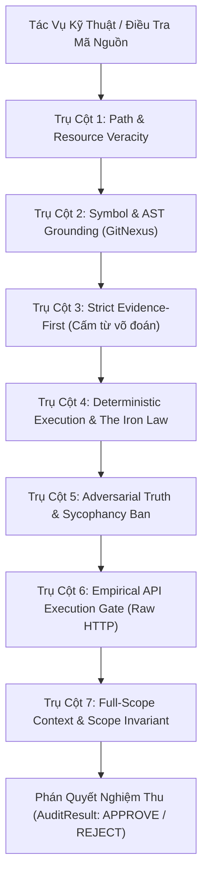

# Anti-Hallucination Guard (Rào Chắn Chống Ảo Giác Thực Chứng Tự Động)

## Tổng Quan & Tuyên Ngôn Cốt Lõi

> **Nguyên tắc bất biến (Autonomous System Invariant):** Không có tuyên bố thành công nào được chấp nhận nếu không có bằng chứng thực chứng tươi mới (Fresh Empirical Evidence). Cơ chế này kích hoạt tự động 100% trong toàn bộ các phiên làm việc của Antigravity 2.0 mà không cần gọi lệnh thủ công.
> *(Kỹ năng tích hợp toàn diện và kế thừa quy chuẩn The Iron Law từ `/verification-before-completion`).*

AI Agents trong các tác vụ phát triển phần mềm và điều phối tự động thường mắc các dạng ảo giác và thiên kiến nguy hiểm:
1. **Ảo giác đường dẫn (Path Hallucination):** Bịa ra file/thư mục không có thật, hoặc suy đoán sai đường dẫn module.
2. **Ảo giác biểu tượng (Symbol/AST Hallucination):** Gọi các hàm, class, thuộc tính hoặc method không hề tồn tại trong mã nguồn.
3. **Ngôn ngữ võ đoán (Speculative Assertions):** Dùng các cụm từ "chắc là sẽ chạy", "should work", "dường như đã pass" thay vì chạy thật.
4. **Tuyên bố thành công giả mạo (Unverified Completion Claims):** Khẳng định tính năng đã xong, test đã pass nhưng không có execution log thực tế với exit code 0.
5. **Thiên kiến xác nhận / Hùa theo người dùng (Sycophancy):** Khi người dùng đưa ra câu hỏi gợi ý hoặc giả định, AI vội vã kết luận "giả thuyết của anh hoàn toàn đúng", "đúng như anh nghi ngờ" mà không qua phản biện độc lập.
6. **Ảo giác quyền hạn API / Hạ tầng (Unverified API Claims):** Phán đoán quyền hạn API bên thứ ba (Free tier gọi được API, Shared voices, ElevenLabs 402, paid_plan_required...) mà không chạy lệnh curl/HTTP test thực tế.
7. **Ảo giác suy diễn cục bộ / Cắt xén phạm vi (Partial Scope & Context Narrowing):** Chỉ đọc 1 vài từ khóa hoặc đoạn code ngắn rồi suy diễn cả kiến trúc hệ thống; nhầm lẫn giữa frontend UI hiển thị và backend worker chạy thực tế.

Hệ thống thiết lập **7 Trụ Cột Rào Chắn Chống Ảo Giác Thực Chứng** kết hợp **Bộ Ba Tác Tử (Dynamic Triad)** và **GitNexus MCP** vận hành tự động.

---

## 7 Trụ Cột Rào Chắn Chống Ảo Giác Thực Chứng (The 7 Pillars of Grounding)



### 1. Trụ Cột 1: Path & Resource Veracity (Kiểm Chứng Tồn Tại Đường Dẫn Vật Lý)
- **Quy tắc:** Bất kỳ đường dẫn file/thư mục nào được trích dẫn trong mã nguồn, tài liệu hoặc báo cáo bàn giao đều phải tồn tại thực tế trên hệ thống tệp vật lý.
- **Quy trình:**
  - Đối soát đường dẫn tương đối dựa trên thư mục gốc dự án (`base_dir`).
  - Đường dẫn tuyệt đối phải được chuẩn hóa an toàn và kiểm tra tồn tại vật lý qua `Path.exists()`.
  - Tuyệt đối cấm tạo tài liệu hướng dẫn hoặc báo cáo trỏ tới các file stub hoặc đường dẫn tưởng tượng.
  - QA Auditor tự động `REJECT` nếu phát hiện bất kỳ file nào không tồn tại trên đĩa.

### 2. Trụ Cột 2: Symbol & AST Grounding (Đối Soát Ký Hiệu & Cú Pháp AST qua GitNexus)
- **Quy tắc:** Không suy đoán tên hàm, class hoặc method signature. Mọi thay đổi và import phải được đối soát qua GitNexus MCP hoặc AST parser.
- **Quy trình:**
  - Maker (Builder) bắt buộc chạy Pre-Flight check: `impact({target: "symbolName", direction: "upstream"})` để đo blast radius và `context()` để đối soát chữ ký/kiểu dữ liệu trước khi sửa code.
  - Sử dụng `verify_symbol_grounding` từ `harness.validators.hallucination_detector` để đối soát symbols trích dẫn trong văn bản với mã nguồn thực tế.
  - Cấm hoàn toàn việc tự tiện bịa method hoặc import không tồn tại.

### 3. Trụ Cột 3: Strict Evidence-First (Triệt Tiêu Hoàn Toàn Ngôn Ngữ Võ Đoán)
- **Quy tắc:** Loại bỏ hoàn toàn ngôn ngữ suy đoán mang tính xác suất hoặc cảm tính.
- **Danh sách cấm (Red Flag Phrases):**
  - Tiếng Anh: `should work`, `probably`, `seems to work`, `looks good to me`, `assuming it passes`, `can't go wrong`, `pretty sure`.
  - Tiếng Việt: `chắc là`, `dường như`, `có lẽ`, `sẽ hoạt động bình thường mà không cần test`, `nghĩ là ổn`, `chắc chắn sẽ chạy`, `không thể sai được`, `chắc ăn`.
- **Hành vi bắt buộc:** Nếu chưa chạy lệnh, ghi rõ: `Chưa chạy kiểm tra thực tế`. Code Critic tự động phán quyết `VERDICT: REJECT` ngay lập tức nếu phát hiện Red Flag Phrases.

### 4. Trụ Cột 4: Deterministic Execution Verification & The Iron Law (Luật Thép Thực Thi Xác Thực)

#### The Iron Law
```
NO COMPLETION CLAIMS WITHOUT FRESH VERIFICATION EVIDENCE
(Tuyệt đối không tuyên bố hoàn tất nếu không có bằng chứng kiểm thử tươi mới trong phiên)
```

Nếu bạn chưa trực tiếp chạy lệnh xác minh ngay trong lượt tương tác hiện tại, bạn **CẤM TUYỆT ĐỐI** tuyên bố tính năng đã pass hoặc hoàn thành.

#### The Gate Function (Hàm Chốt Chặn 5 Bước)
Trước khi tuyên bố bất kỳ trạng thái nào hoặc thể hiện sự hài lòng:
1. **IDENTIFY:** Lệnh chính xác nào chứng minh cho tuyên bố này?
2. **RUN:** Chạy TOÀN BỘ lệnh kiểm thử (mới nhất, đầy đủ, không cắt xén).
3. **READ:** Đọc toàn bộ đầu ra log, kiểm tra `exit code == 0`, đếm số lỗi/failures.
4. **VERIFY:** Kết quả có thực sự xác nhận tuyên bố không?
   - Nếu KHÔNG: Khai báo trung thực trạng thái thực tế kèm toàn bộ log lỗi.
   - Nếu CÓ: Khẳng định hoàn tất KÈM THEO bằng chứng log và exit code 0.
5. **ONLY THEN:** Đưa ra kết luận hoặc bàn giao. Bỏ qua bất kỳ bước nào đồng nghĩa với ngụy tạo bằng chứng.

### 5. Trụ Cột 5: Adversarial Truth & Sycophancy Ban (Cấm Hùa Theo Giả Thuyết)
- **Bản chất rủi ro:** Khi người dùng nêu nghi vấn ("Có phải họ dùng shared voices không?", "Hình như proxy backend này chặn IP?"), tác tử thường tìm cách làm hài lòng người dùng bằng cách hùa theo ("Đúng như anh nghi ngờ", "Giả thuyết của anh đúng 90%").
- **Thiết luật cưỡng bức:**
  - **CẤM TUYỆT ĐỐI** khẳng định giả thuyết là đúng nếu chưa tiến hành thực nghiệm đối kháng độc lập.
  - Bắt buộc kiểm tra 2 chiều (Falsification Test): Đặt câu hỏi *"Dữ liệu/mã nguồn nào chứng minh giả thuyết này SAI?"* trước khi tìm kiếm bằng chứng xác nhận.
  - Phạt nặng và tự động `REJECT` nếu xuất hiện các mẫu câu:
    + Tiếng Việt: `giả thuyết của anh đúng`, `đúng như anh nghi ngờ/dự đoán`, `hoàn toàn trùng khớp với giả định`, `chắc chắn là họ dùng`.
    + Tiếng Anh: `your hypothesis is correct`, `confirms your assumption/suspicion`, `exactly as you suspected`, `proves your theory`.

### 6. Trụ Cột 6: Empirical API & Investigation Evidence Gate (Khóa Cứng Bằng Chứng API Thực Nghiệm)
- **Bản chất rủi ro:** Suy diễn quyền hạn API của bên thứ ba, giả định gói miễn phí được gọi endpoint trả phí, hoặc phán đoán server backend mà chỉ dựa trên tên hàm hay phỏng đoán.
- **Thiết luật cưỡng bức:**
  - **CẤM TUYỆT ĐỐI** kết luận về:
    + Quyền hạn tài khoản API (Free tier vs Paid plan, quota, endpoint permissions).
    + Các lỗi nghiệp vụ phụ thuộc server (ElevenLabs 402 Payment Required, 401 Unauthorized, rate limit).
    + Hạ tầng proxy/backend đang hoạt động hay chặn yêu cầu.
  - **Bắt buộc raw HTTP Evidence:** Mọi tuyên bố về API phải đi kèm log chạy lệnh thực tế (curl, python script, fetch) chứa mã phản hồi HTTP raw:
    + `HTTP 200`, `HTTP 401`, `HTTP 402 Payment Required`, `HTTP 403 Forbidden`...
    + Trường hợp lỗi: Phải trích dẫn nguyên văn payload JSON phản hồi từ nhà cung cấp (ví dụ: `{"detail": {"status": "paid_plan_required", "message": "..."}}`).
  - Thiếu raw HTTP status code $\rightarrow$ Tự động bị `verify_api_and_investigation_claims` phạt vi phạm và `REJECT`.

### 7. Trụ Cột 7: Full-Scope Context & Scope Invariant (Kỷ Luật Ngữ Cảnh Đầy Đủ & Chống Thu Hẹp Phạm Vi)
- **Bản chất rủi ro:**
  - *Context Narrowing:* Chỉ trích 1 vài dòng chứa từ khóa rồi suy diễn cả luồng dữ liệu mà bỏ qua điều kiện bao bọc (if/else, guard clause, exception handling).
  - *UI vs Worker Boundary Fallacy:* Nhầm lẫn giữa mã nguồn UI Frontend (hiển thị danh sách, dropdown) và mã nguồn Backend Worker (thực thi API thật, token management).
  - *Scope Reduction:* Thu nhỏ bài toán lớn thành mockup sơ sài.
- **Thiết luật cưỡng bức:**
  - **Đọc tối thiểu 50 dòng trước và sau:** Khi phân tích một hàm, route hoặc block logic, bắt buộc đọc tối thiểu 50 dòng trước và 50 dòng sau điểm xuất hiện để xác minh toàn bộ luồng rẽ nhánh và ngữ cảnh thực thi.
  - **Phân định ranh giới Frontend UI vs Backend Worker:** Bắt buộc truy vết điểm giao thoa mạng (Network boundary: IPC message, REST call, websocket, fetch). Sự xuất hiện của một giá trị trên giao diện KHÔNG đồng nghĩa với việc backend hỗ trợ thực thi giá trị đó.
  - **Feature Parity Inventory 1:1:** Với bài toán clone/rebuild/refactor (>20 files), Maker bắt buộc lập bảng kiểm kê 1:1 và chia nhỏ Milestones độc lập trước khi viết code.

---

## Chuẩn Hóa Khung Bảng 3 Cột Thực Chứng (Evidence Table)

Khi thực hiện điều tra kỹ thuật, thẩm định API, khảo sát mã nguồn đảo ngược hoặc giải quyết nghi vấn phức tạp, báo cáo bàn giao **BẮT BUỘC** trình bày dữ liệu theo định dạng Bảng 3 Cột Thực Chứng:

| Vấn Đề Nghi Vấn | Lệnh Thực Nghiệm & Raw Response | Kết Luận Thực Chứng |
|:---|:---|:---|
| Giả thuyết / Câu hỏi kỹ thuật cần xác minh | Lệnh thực thi chính xác (curl, python, pytest) kèm HTTP status hoặc exit code thực tế | Phán quyết dựa trên sự thật khách quan (ĐÚNG / SAI / KHÔNG CÓ CƠ SỞ) |

> **Quy chuẩn:** Bảng phải có đầy đủ 3 tiêu đề cột hợp lệ và tối thiểu 1 dòng dữ liệu thực chứng. Nếu thiếu, kiểm toán `verify_evidence_table` sẽ đánh dấu vi phạm.

---

## Tiêu Chí Đánh Giá Nghiệm Thu (Audit Result Rubric)

Mọi báo cáo bàn giao của SubAgent tự động đối soát qua `harness/validators/hallucination_detector.py`:

| Tiêu Chí | Ngưỡng Cho Phép | Hành Động Khi Vi Phạm |
| :--- | :--- | :--- |
| **Path Hallucination** | 0 file không tồn tại | `REJECT` - Bắt buộc sửa đường dẫn hoặc tạo file |
| **Symbol Hallucination** | 0 symbol ảo ngoài AST/GitNexus | `REJECT` - Đối soát lại chữ ký hàm qua GitNexus |
| **Speculative Language** | 0 cụm từ võ đoán | `REJECT` - Viết lại báo cáo bằng chứng thực |
| **Unverified Claim** | 0 tuyên bố thiếu log exit 0 | `REJECT` - Chạy lệnh và đính kèm execution log |
| **Sycophancy (Hùa theo)** | 0 cụm từ xác nhận thiên kiến | `REJECT` - Kiểm định đối kháng 2 chiều khách quan |
| **API & Infra Claims** | Bắt buộc raw HTTP code (200/401/402) | `REJECT` - Chạy lệnh thực nghiệm lấy raw response |
| **Context Scope** | >= 50 dòng trước/sau, rõ ranh giới UI/Worker | `REJECT` - Mở rộng ngữ cảnh đọc mã nguồn |
| **Evidence Table** | Đầy đủ bảng 3 cột khi điều tra kỹ thuật | `REJECT` - Chuẩn hóa báo cáo theo bảng 3 cột |

---

## Phân Định Trách Nhiệm Tự Động Trong Bộ Ba Tác Tử

1. **Maker (Builder):**
   - Tiền kiểm GitNexus Pre-Flight (`impact`, `context`) trước khi sửa bất kỳ symbol nào.
   - Luôn đính kèm output lệnh thật với `exit code == 0`, raw HTTP status, và đường dẫn file vật lý có thật.
   - Lập Evidence Table 3 cột cho mọi bài toán điều tra.

2. **Critic (Code Critic):**
   - Đóng vai trò bộ lọc Strict Evidence: quét rà soát Red Flag Phrases, Sycophancy và Spec GAP.
   - Bác bỏ (`VERDICT: REJECT`) ngay nếu Maker hùa theo giả định người dùng, phỏng đoán API không có raw HTTP hoặc suy diễn cục bộ dưới 50 dòng context.

3. **QA Auditor (Checker):**
   - Rà soát 100% đường dẫn vật lý trên đĩa.
   - Rerun độc lập toàn bộ các test commands và chỉ duyệt (`VERDICT: APPROVE`) khi có kết quả `exit code 0` thật và bằng chứng đối chứng 2 chiều đầy đủ.

---

## Kiến Trúc Thực Thi Tự Động (Runtime Enforcement Architecture)

Rào chắn chống ảo giác được cưỡng chế thực thi tự động qua 3 tầng vật lý:

1. **Antigravity 2.0 Lifecycle `Stop` Hook (`scripts/enforce_anti_hallucination_hook.py`):**
   - Được đăng ký trực tiếp trong `.agents/hooks.json` và `.agent/hooks.json` tại sự kiện `Stop`.
   - Đọc `transcriptPath` (JSONL) từ payload `stdin` của Antigravity, trích xuất toàn bộ các bước sau `USER_INPUT` mới nhất, thu thập execution logs từ các bước chạy tool/command (`Command exited with code 0`, HTTP status code) và kiểm toán phản hồi `PLANNER_RESPONSE` cuối cùng thông qua `audit_response` (`harness/validators/hallucination_detector.py`).
   - Nếu phát hiện ngôn ngữ võ đoán, câu hùa theo người dùng (Sycophancy), hoặc tuyên bố hoàn thành/API thiếu bằng chứng thực thi, hook trả về `{"decision": "continue", "reason": "[ANTI-HALLUCINATION-GUARD] ..."}` buộc tác tử sửa lại câu trả lời kèm bằng chứng thật.
   - Tích hợp **Circuit Breaker (`max_retries = 2`)**: Tự động đếm số lần `[ANTI-HALLUCINATION-GUARD]` đã kích hoạt trong lượt hiện tại (hoặc `executionNum > 2`) để trả về `{"decision": "allow"}`, ngăn chặn vòng lặp vô hạn.

2. **Chốt Chặn Bàn Giao SubAgent (`harness/app_workflow.py`):**
   - `AppWorkflowStore.audit_handoff_text()` tích hợp trực tiếp `harness/validators/hallucination_detector.py` vào các bước chuyển giao `submit_implementation`, `review_code`, và `audit`.
   - Lưu biên lai `hallucination_audit` vào trạng thái workflow và tự động bác bỏ (`WorkflowError` / `REJECT`) nếu báo cáo bàn giao chứa ngôn ngữ võ đoán, thiên kiến xác nhận hoặc tuyên bố thiếu bằng chứng thực thi.

3. **Always-On Invariants (`GEMINI.md` Mục 14):**
   - Quy chuẩn Rào Chắn Chống Ảo Giác Tự Động & Kỷ Luật Phạm Vi luôn được nạp trong ngữ cảnh hệ thống của Quản đốc và toàn bộ SubAgents.

