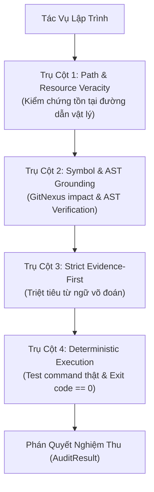

# Anti-Hallucination Guard (Rào Chắn Chống Ảo Giác Thực Chứng Tự Động)

## Tổng Quan & Tuyên Ngôn Cốt Lõi

> **Nguyên tắc bất biến (Autonomous System Invariant):** Không có tuyên bố thành công nào được chấp nhận nếu không có bằng chứng thực chứng tươi mới (Fresh Empirical Evidence). Cơ chế này kích hoạt tự động 100% trong toàn bộ các phiên làm việc của Antigravity 2.0 mà không cần gọi lệnh thủ công.

AI Agents trong các tác vụ phát triển phần mềm và điều phối tự động thường mắc các dạng ảo giác nguy hiểm:
1. **Ảo giác đường dẫn (Path Hallucination):** Bịa ra file/thư mục không có thật, hoặc suy đoán sai đường dẫn module.
2. **Ảo giác biểu tượng (Symbol/AST Hallucination):** Gọi các hàm, class, thuộc tính hoặc method không hề tồn tại trong mã nguồn.
3. **Ngôn ngữ võ đoán (Speculative Assertions):** Dùng các cụm từ "chắc là sẽ chạy", "should work", "dường như đã pass" thay vì chạy thật.
4. **Tuyên bố thành công giả mạo (Unverified Completion Claims):** Khẳng định tính năng đã xong, test đã pass nhưng không có execution log thực tế với exit code 0.

Hệ thống thiết lập **4 Trụ Cột Rào Chắn Chống Ảo Giác** kết hợp **Bộ Ba Tác Tử (Dynamic Triad)** và **GitNexus MCP** vận hành tự động.

---

## 4 Trụ Cột Rào Chắn Chống Ảo Giác (The 4 Pillars of Grounding)

### 1. Trụ Cột 1: Path & Resource Veracity (Kiểm Chứng Tồn Tại Đường Dẫn)
- **Quy tắc:** Bất kỳ đường dẫn file/thư mục nào được trích dẫn trong mã nguồn, tài liệu hoặc báo cáo bàn giao đều phải tồn tại thực tế trên hệ thống tệp vật lý.
- **Quy trình:**
  - Đối soát đường dẫn tương đối dựa trên thư mục gốc dự án (`base_dir`).
  - Đường dẫn tuyệt đối phải được chuẩn hóa an toàn và kiểm tra tồn tại vật lý qua `Path.exists()`.
  - Tuyệt đối cấm tạo tài liệu hướng dẫn hoặc báo cáo trỏ tới các file stub hoặc đường dẫn tưởng tượng.
  - QA Auditor tự động `REJECT` nếu phát hiện bất kỳ file nào không tồn tại trên đĩa.

### 2. Trụ Cột 2: Symbol & AST Grounding (Đối Soát Ký Hiệu & Cú Pháp AST qua GitNexus)
- **Quy tắc:** Không suy đoán tên hàm, class hoặc method signature. Mọi thay đổi và import phải được đối soát qua GitNexus MCP hoặc AST parser.
- **Quy trình:**
  - Maker (Builder) bắt buộc chạy Pre-Flight check: `impact({target: "symbolName", direction: "upstream"})` để đo blast radius và `context()` để đối soát chữ ký/kiểu dữ liệu trước khi sửa code.
  - Sử dụng `verify_symbol_grounding` từ `harness.validators.hallucination_detector` để đối soát symbols trích dẫn trong văn bản với mã nguồn thực tế.
  - Cấm hoàn toàn việc tự tiện bịa method hoặc import không tồn tại.

### 3. Trụ Cột 3: Strict Evidence-First (Cấm Ngôn Ngữ Võ Đoán)
- **Quy tắc:** Loại bỏ hoàn toàn ngôn ngữ suy đoán mang tính xác suất hoặc cảm tính.
- **Danh sách cấm (Red Flag Phrases):**
  - Tiếng Anh: `should work`, `probably`, `seems to work`, `looks good to me`, `assuming it passes`, `can't go wrong`, `pretty sure`.
  - Tiếng Việt: `chắc là`, `dường như`, `có lẽ`, `sẽ hoạt động bình thường mà không cần test`, `nghĩ là ổn`, `chắc chắn sẽ chạy`, `không thể sai được`, `chắc ăn`.
- **Hành vi bắt buộc:** Nếu chưa chạy lệnh, ghi rõ: `Chưa chạy kiểm tra thực tế`. Code Critic tự động phán quyết `VERDICT: REJECT` ngay lập tức nếu phát hiện Red Flag Phrases.

### 4. Trụ Cột 4: Deterministic Execution Verification (Xác Minh Thực Thi Xác Thực)
- **Quy tắc:** Tuyên bố "Pass", "Hoàn thành", "Sửa thành công" bắt buộc phải đi kèm block log thực thi thực tế với `exit code == 0`.
- **Quy trình:**
  1. Maker đính kèm command, cwd, exit code và stdout/stderr thực tế.
  2. QA Auditor chạy lại độc lập (rerun) toàn bộ các lệnh kiểm thử trong subshell riêng biệt.
  3. Nếu exit code != 0 hoặc thiếu log: phán quyết `FAIL / REJECT` ngay lập tức.

---

## Tiêu Chí Đánh Giá Nghiệm Thu (Audit Result Rubric)

Mọi báo cáo bàn giao của SubAgent tự động đối soát qua `harness/validators/hallucination_detector.py`:

| Tiêu Chí | Ngưỡng Cho Phép | Hành Động Khi Vi Phạm |
| :--- | :--- | :--- |
| **Path Hallucination** | 0 file không tồn tại | `REJECT` - Bắt buộc sửa đường dẫn hoặc tạo file |
| **Symbol Hallucination** | 0 symbol ảo ngoài AST/GitNexus | `REJECT` - Đối soát lại chữ ký hàm qua GitNexus |
| **Speculative Language** | 0 cụm từ võ đoán | `REJECT` - Viết lại báo cáo bằng chứng thực |
| **Unverified Claim** | 0 tuyên bố thiếu log | `REJECT` - Chạy lệnh và đính kèm execution log |
| **Execution Exit Code** | Bắt buộc `code == 0` | `FAIL` - Báo cáo lỗi kỹ thuật cho Maker fix |

---

## Phân Định Trách Nhiệm Tự Động Trong Bộ Ba Tác Tử

1. **Maker (Builder):**
   - Tiền kiểm GitNexus Pre-Flight (`impact`, `context`) trước khi sửa bất kỳ symbol nào.
   - Luôn đính kèm output lệnh thật với `exit code == 0` và đường dẫn file vật lý có thật.

2. **Critic (Code Critic):**
   - Đóng vai trò bộ lọc Strict Evidence: quét rà soát Red Flag Phrases và Spec GAP.
   - Bác bỏ (`VERDICT: REJECT`) ngay nếu Maker dùng từ ngữ phỏng đoán hoặc thiếu log chứng thực.

3. **QA Auditor (Checker):**
   - Rà soát 100% đường dẫn vật lý trên đĩa.
   - Rerun độc lập toàn bộ các test commands và chỉ duyệt (`VERDICT: APPROVE`) khi có kết quả `exit code 0` thật.
