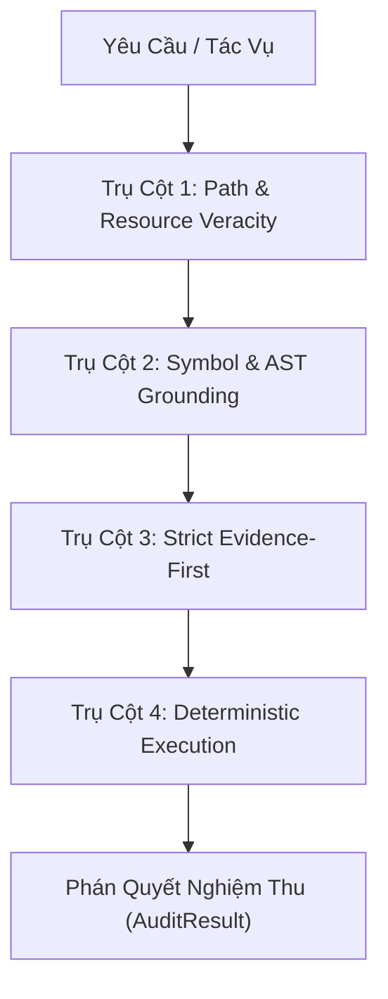

# Anti-Hallucination Guard (Rào Chắn Chống Ảo Giác Thực Chứng)

## Tổng Quan & Tuyên Ngôn Cốt Lõi

> **Nguyên tắc bất biến:** Không có tuyên bố thành công nào được chấp nhận nếu không có bằng chứng thực chứng tươi mới (Fresh Empirical Evidence).

AI Agents trong các tác vụ phát triển phần mềm và điều phối tự động thường mắc các dạng ảo giác nguy hiểm:
1. **Ảo giác đường dẫn (Path Hallucination):** Bịa ra file/thư mục không có thật, hoặc suy đoán sai đường dẫn module.
2. **Ảo giác biểu tượng (Symbol/AST Hallucination):** Gọi các hàm, class, thuộc tính hoặc method không hề tồn tại trong mã nguồn.
3. **Ngôn ngữ võ đoán (Speculative Assertions):** Dùng các cụm từ "chắc là sẽ chạy", "should work", "dường như đã pass" thay vì chạy thật.
4. **Tuyên bố thành công giả mạo (Unverified Completion Claims):** Khẳng định tính năng đã xong, test đã pass nhưng không có execution log thực tế với exit code 0.

Kỹ năng này thiết lập **4 Trụ Cột Rào Chắn Chống Ảo Giác** bắt buộc mọi tác tử Maker, Critic và QA Auditor phải tuân thủ nghiêm ngặt.

---

## 4 Trụ Cột Rào Chắn Chống Ảo Giác (The 4 Pillars of Grounding)

### 1. Trụ Cột 1: Path & Resource Veracity (Kiểm Chứng Tồn Tại Đường Dẫn)
- **Quy tắc:** Bất kỳ đường dẫn file/thư mục nào được trích dẫn trong mã nguồn, tài liệu hoặc báo cáo bàn giao đều phải tồn tại thực tế trên hệ thống tệp.
- **Quy trình:**
  - Đối soát đường dẫn tương đối dựa trên thư mục gốc dự án (`base_dir`).
  - Đường dẫn tuyệt đối phải được chuẩn hóa an toàn và kiểm tra tồn tại vật lý.
  - Tuyệt đối cấm tạo tài liệu hướng dẫn trỏ tới các file stub hoặc đường dẫn tưởng tượng.

### 2. Trụ Cột 2: Symbol & AST Grounding (Đối Soát Ký Hiệu & Cú Pháp AST)
- **Quy tắc:** Không suy đoán tên hàm, class hoặc method. Mọi import và method call phải được đối soát qua AST parser hoặc danh mục known symbols.
- **Quy trình:**
  - Sử dụng công cụ đọc code hoặc `view_file` để kiểm tra định nghĩa hàm trước khi gọi hoặc tham chiếu.
  - Phân tích cú pháp AST khi can thiệp vào các symbol lõi để đảm bảo tương thích signature và type annotations.

### 3. Trụ Cột 3: Strict Evidence-First (Cấm Ngôn Ngữ Võ Đoán)
- **Quy tắc:** Loại bỏ hoàn toàn ngôn ngữ suy đoán mang tính xác suất hoặc cảm tính.
- **Danh sách cấm (Red Flag Phrases):**
  - Tiếng Anh: `should work`, `probably`, `seems to work`, `looks good to me`, `assuming it passes`.
  - Tiếng Việt: `chắc là`, `dường như`, `có lẽ`, `sẽ hoạt động bình thường mà không cần test`, `nghĩ là ổn`.
- **Hành vi bắt buộc:** Nếu chưa chạy lệnh, ghi rõ: `Chưa chạy kiểm tra thực tế`. Không được dùng từ mang ý nghĩa khẳng định khi thiếu log.

### 4. Trụ Cột 4: Deterministic Execution Verification (Xác Minh Thực Thi Xác Thực)
- **Quy tắc:** Tuyên bố "Pass", "Hoàn thành", "Sửa thành công" bắt buộc phải đi kèm block log thực thi thực tế với exit code 0.
- **Quy trình:**
  1. Chỉ định lệnh kiểm tra chính xác (ví dụ: `pytest tests/...`).
  2. Chạy lệnh thực tế và thu nhận stdout/stderr.
  3. Trích xuất exit code và kết quả pass/fail thực tế.
  4. Nếu exit code != 0 hoặc không có log: phán quyết `FAIL / REJECT` ngay lập tức.

---

## Tiêu Chí Đánh Giá Nghiệm Thu (Audit Result Rubric)

Mọi báo cáo bàn giao của SubAgent phải được kiểm tra qua bộ lọc `harness/validators/hallucination_detector.py`:

| Tiêu Chí | Ngưỡng Cho Phép | Hành Động Khi Vi Phạm |
| :--- | :--- | :--- |
| **Path Hallucination** | 0 file không tồn tại | `REJECT` - Bắt buộc sửa đường dẫn hoặc tạo file |
| **Speculative Language** | 0 cụm từ võ đoán | `REJECT` - Viết lại báo cáo bằng chứng thực |
| **Unverified Claim** | 0 tuyên bố thiếu log | `REJECT` - Chạy lệnh và đính kèm execution log |
| **Execution Exit Code** | Bắt buộc `code == 0` | `FAIL` - Báo cáo lỗi kỹ thuật cho Maker fix |

---

## Hướng Dẫn Sử Dụng Trong Quy Trình Tác Tử

1. **Maker (Builder / Creator):**
   - Trước khi gửi báo cáo hoàn thành, tự đối soát theo 4 trụ cột.
   - Luôn đính kèm output lệnh thật và đường dẫn file thật.

2. **Critic (Code Critic):**
   - Quét qua `detect_speculative_language` và kiểm tra tính xác thực của các reference.
   - Bác bỏ ngay nếu Maker dùng từ ngữ phỏng đoán.

3. **QA Auditor (Checker):**
   - Dùng `audit_response` từ `harness.validators.hallucination_detector` để rà soát toàn bộ văn bản bàn giao.
   - Rerun độc lập toàn bộ các test command mà Maker tuyên bố đã pass.
