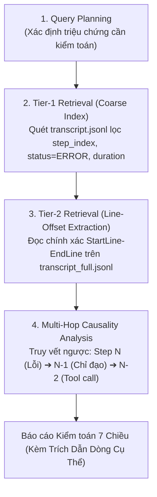

# Kiểm Toán Phiên Làm Việc Tác Tử Bằng Log Agentic RAG (Diagnosing Harness)

## Tổng Quan (Overview)

Chẩn đoán và kiểm toán chuyên sâu những gì đã diễn ra trong một phiên làm việc của tác tử (session audit) bằng mô hình **Log Agentic RAG hai tầng (Two-Tier Retrieval)**: phát hiện lặp lại công việc vô ích, cháy token, chệch hướng kế hoạch, kẹt vòng lặp hoặc thất bại không rõ nguyên nhân mà **không làm phình context window** ngay cả khi log nặng hàng chục MB.

**Nguyên tắc cốt lõi:**
- **Two-Tier Read Invariant:** Tuyệt đối KHÔNG đọc toàn bộ file `transcript_full.jsonl`. Chỉ đọc `transcript.jsonl` để định vị bước lỗi, sau đó dùng `read_file(StartLine, EndLine)` trích xuất đúng dòng cần thiết từ `transcript_full.jsonl`.
- **Strict Evidence Attribution:** Mọi phát hiện đều phải trích dẫn chính xác `path#L<line>` hoặc `step_index` từ log transcript thực tế.
- **Read-Only Invariant:** Chỉ đọc log ở chế độ Read-Only, không chỉnh sửa hay xóa file transcript của hệ thống.

---

## Vị Trí Transcript Hệ Thống

Trong môi trường Antigravity, log hội thoại được lưu tại đường dẫn thư mục AppData:
- Thư mục session: `.gemini/antigravity/brain/<session-id>/.system_generated/logs/`
- File transcript cô đọng: `transcript.jsonl` (chỉ mục tổng quan)
- File transcript đầy đủ: `transcript_full.jsonl` (chi tiết nội dung, tool calls và CoT thinking)

Cấu trúc mỗi dòng JSONL gồm các trường metadata chuẩn: `step_index`, `source`, `type`, `status`, `created_at`, `content`, `thinking`, `tool_calls`, `truncated_fields`.

---

## Quy Trình Log Agentic RAG 4 Bước



### Bước 1: Query Planning (Xác định triệu chứng cần kiểm toán)
Xác định câu hỏi điều tra cụ thể:
- *Tại sao tác tử bị kẹt vòng lặp (loop) ở bước nào?*
- *Bước nào gây bùng nổ token hoặc chạy quá lâu?*
- *Tool nào bị fail và lỗi trả về nguyên văn là gì?*
- *Tác tử có bị chệch hướng (drift) so với kế hoạch ban đầu sau khi nén ngữ cảnh (compaction) không?*

### Bước 2: Tier-1 Retrieval (Quét chỉ mục nhanh trên `transcript.jsonl`)
- Đọc file `transcript.jsonl` (bản compact) hoặc dùng script PowerShell/grep để quét nhanh các dòng có:
  - `status: "ERROR"`
  - `truncated_fields` có chứa `["content"]`, `["thinking"]` hoặc `["tool_calls"]`
  - Khoảng cách thời gian `created_at` giữa 2 bước liên tiếp bất thường (> 60s)
  - Các chuỗi tool calls bị gọi lặp lại liên tiếp.

### Bước 3: Tier-2 Retrieval (Trích xuất sâu theo Line-Offset)
- Khi phát hiện `step_index` hoặc dòng nghi vấn tại dòng $K$ của `transcript.jsonl`:
  - Dùng `read_file` trỏ vào `transcript_full.jsonl` với `StartLine: K, EndLine: K` để đọc đầy đủ payload của riêng bước đó.
  - Tuyệt đối không đọc phạm vi quá 20 dòng một lần để bảo toàn ngân sách ngữ cảnh.

### Bước 4: Multi-Hop Causality Analysis (Truy vết nhân quả đa bước)
Khi phát hiện lỗi ở bước $N$:
- **Hop 1:** Xem nguyên văn lỗi trả về trong `tool_calls` hoặc `content` ở bước $N$.
- **Hop 2:** Truy ngược về bước $N-1$ (`PLANNER_RESPONSE`): Xem thinking của tác tử suy luận gì trước khi ra quyết định sai.
- **Hop 3:** Truy ngược về bước $N-2$: Xem kết quả của công cụ trước đó có bị hiểu sai ngữ cảnh không.
- **Hop 4:** Đối chiếu với bước 0/1 (User Prompt & Initial Spec) xem tác tử có tự ý mở rộng phạm vi (scope creep) hay không.

---

## Phân Tích 7 Chiều Toàn Diện (The 7 Audit Dimensions)

Báo cáo kiểm toán tổng hợp theo 7 chiều kỹ thuật:

1. **Dòng Thời Gian Kỹ Năng (Skill Timeline):** Thứ tự kích hoạt các skill và subagent; kỹ năng nào bị gọi nhầm hoặc bỏ qua.
2. **Lặp Lại Công Việc (Repeated Work):** Các lệnh gọi công cụ trùng lặp (`view_file`, `grep` vô nghĩa) không tạo ra giá trị mới.
3. **Bám Sát Kế Hoạch (Plan Adherence):** Mức độ bám sát Spec ban đầu; độ chệch hướng sau sự kiện context compaction.
4. **Chi Phí & Thời Gian (Cost & Time):** Wall-clock duration từng turn; xác định điểm nghẽn làm bùng nổ token.
5. **Trở Ngại & Vấp Ngã (Stumbles):** Danh sách tool failures, command exit code khác 0, ngoại lệ hệ thống.
6. **Bằng Chứng Chất Lượng (Quality Evidence):** Kết luận hoàn thành có kèm bằng chứng test thực tế (`exit code == 0`) hay chỉ là khẳng định suông.
7. **Xung Đột Yêu Cầu (Request Conflicts):** Mâu thuẫn giữa yêu cầu của Sếp và quy chuẩn hệ thống, hoặc giữa các turn chat khác nhau.

---

## Mẫu Biên Bản Kiểm Toán Handoff Chuẩn

```markdown
### BIÊN BẢN KIỂM TOÁN PHIÊN TÁC TỬ
- **Session ID:** <session-id>
- **Số bước phân tích:** Step <from> -> Step <to>
- **Kết luận chung:** [PASS / WARN / CRITICAL_FAIL]

#### 1. Phát Hiện Chính (Điểm Nghẽn & Lỗi)
- **Lỗi chính:** [Tóm tắt lỗi trong 1 dòng]
- **Dẫn chứng Log:** `transcript.jsonl#L<line>` (Step <index>)
- **Nguyên văn lỗi:** `transcript_full.jsonl#L<line>`

#### 2. Phân Tích Nhân Quả (Causality Chain)
- Step N-2: ...
- Step N-1: ...
- Step N (Gây lỗi): ...

#### 3. Khuyến Nghị Khắc Phục (Actionable Fixes)
- [ ] Điều chỉnh prompt / skill hướng dẫn...
- [ ] Bổ sung circuit-breaker cho tool...
```
