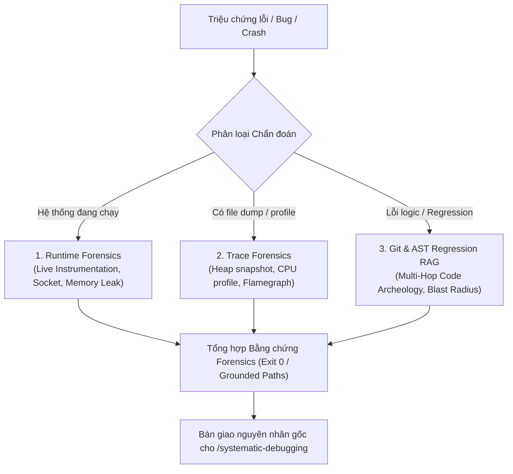

# Skill: /forensics — Chẩn Đoán Lỗi Chuyên Sâu & Khảo Cổ Hồi Quy

Chẩn đoán chuyên sâu trước khi can thiệp vào mã nguồn nhằm tìm kiếm nguồn gốc lỗi ngầm, race condition và hồi quy mã nguồn bằng mô hình **Multi-Hop Forensics RAG**.

---

## Ba Nhánh Chẩn Đoán Cốt Lõi

### 1. Runtime Forensics (Chẩn đoán Runtime Trực Tiếp)
- **Mục tiêu:** Chẩn đoán các triệu chứng sống: rò rỉ bộ nhớ (memory leak), CPU spin ở trạng thái chờ (idle CPU spin), socket leak, nghẽn Garbage Collector (GC thrashing).
- **Phương pháp:** Live instrumentation (đo đạc trực tiếp tiến trình đang hoạt động qua metrics/logs thực tế).

### 2. Trace Forensics (Chẩn đoán Vết Profile Ngoại Tuyến)
- **Mục tiêu:** Bóc tách các artifact profiling ngoại tuyến: `.cpuprofile`, `.heapsnapshot`, Chrome trace JSON, Flamegraph, OTEL spans.
- **Phương pháp:** Trích xuất các hot frames (khung gọi thường xuyên nhất) và retention paths (chuỗi đối tượng giữ bộ nhớ không giải phóng).

### 3. Git & AST Regression RAG (Khảo Cổ Hồi Quy Mã Nguồn Đa Chặng)
Áp dụng cơ chế **Agentic RAG đa chặng** để truy vết chính xác commit gây ra bug hồi quy (regression):

- **Hop 1 (Symbol Anchor & Line History):**
  - Dùng `git log -L <start>,<end>:<file>` để xem toàn bộ lịch sử biến đổi của khối mã bị lỗi.
  - Sử dụng `git log -S "<tên_hàm>" --oneline` để xác định thời điểm ký tự/hàm này được đưa vào hoặc sửa đổi.
- **Hop 2 (Parent Commit & PR Context Traversal):**
  - Truy xuất diff của commit khả nghi (`git show <commit_hash>`).
  - Kiểm tra commit message, PR descriptions để hiểu mục đích ban đầu (intent) của lập trình viên khi sửa đoạn mã đó.
- **Hop 3 (GitNexus Blast Radius & AST Grounding):**
  - Chạy `impact()` và `context()` từ GitNexus để xác định những hàm/module nào đang gọi đến khối mã lỗi.
  - Xác định xem lỗi phát sinh tại chính hàm đó hay do dữ liệu đầu vào từ một caller bên ngoài bị thay đổi format.

---

## Tiêu Chuẩn Báo Cáo Forensics (Evidence-First)

Mọi báo cáo chẩn đoán phải tuân thủ nghiêm ngặt chuẩn chứng cứ:
1. **Phả hệ lỗi (Genealogy of Bug):** Commit khởi tạo $\rightarrow$ commit refactor làm lệch logic $\rightarrow$ caller kích hoạt.
2. **Dẫn chứng vật lý:** File path, dòng code, commit SHA, hot frame name, hoặc thông số heap retention cụ thể.
3. **Phán quyết:** Chỉ rõ lỗi do Runtime Leak, Logic Regression hay Race Condition trước khi chuyển giao sang bước sửa mã.
