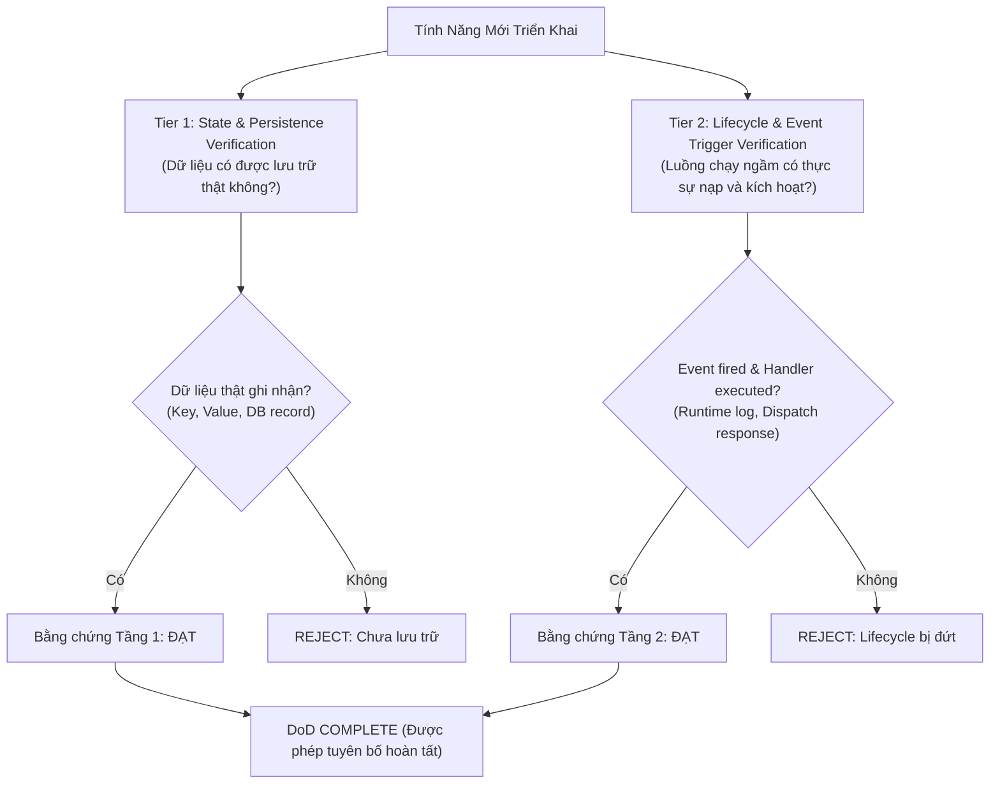

# Verification Before Completion

## Overview

**Core principle:** Evidence before claims, always.

**Violating the letter of this rule is violating the spirit of this rule.**

## The Iron Law

```
NO COMPLETION CLAIMS WITHOUT FRESH VERIFICATION EVIDENCE
```

If you haven't run the verification command in this message, you cannot claim it passes.

## The Gate Function

```
BEFORE claiming any status or expressing satisfaction:

1. IDENTIFY: What command proves this claim?
2. RUN: Execute the FULL command (fresh, complete)
3. READ: Full output, check exit code, count failures
4. VERIFY: Does output confirm the claim?
   - If NO: State actual status with evidence
   - If YES: State claim WITH evidence
5. ONLY THEN: Make the claim

Skip any step = lying, not verifying
```

## Common Failures

| Claim | Requires | Not Sufficient |
|-------|----------|----------------|
| Tests pass | Test command output: 0 failures | Previous run, "should pass" |
| Linter clean | Linter output: 0 errors | Partial check, extrapolation |
| Build succeeds | Build command: exit 0 | Linter passing, logs look good |
| Bug fixed | Test original symptom: passes | Code changed, assumed fixed |
| Regression test works | Red-green cycle verified | Test passes once |
| Agent completed | VCS diff shows changes | Agent reports "success" |
| Requirements met | Line-by-line checklist | Tests passing |
| Syntax vs Runtime | 2-Tier Evidence (State & Lifecycle) | `node --check`, `py_compile`, `tsc --noEmit` |

## 2-Tier Definition of Done (DoD) & Runtime Evidence Protocol

> [!CAUTION]
> **Cú Pháp Tĩnh $\ne$ Hoạt Động Runtime (Syntax Check is NOT Functional Proof)**
> Lệnh `node --check` hay `tsc --noEmit` chỉ chứng minh parser đọc được cú pháp, HOÀN TOÀN KHÔNG chứng minh code chạy được trong môi trường thật (Chrome Extension, Browser runtime, OS hooks).

Để được công nhận hoàn thành một tính năng (Definition of Done), Maker & QA bắt buộc phải thu thập bằng chứng từ **2 Tầng Thực Nghiệm**:



### 1. Tier 1: State & Persistence Verification (Tầng Lưu Trữ & Trạng Thái)
- **Yêu cầu:** Dữ liệu đầu ra, token, settings, hoặc kết quả xử lý phải được ghi nhận thực tế vào Storage/Database/File.
- **Bằng chứng bắt buộc:**
  - Với Web/Extension: Trích xuất trực tiếp giá trị từ `chrome.storage.local.get()` hoặc `localStorage` (chỉ rõ key, value thật).
  - Với Backend/App: Trích xuất bản ghi trong SQLite, file JSON cấu hình, hoặc file cache vật lý trên đĩa.
  - CẤM: Chỉ in console.log trong bộ nhớ RAM mà không kiểm chứng ghi xuống disk/storage.

### 2. Tier 2: Lifecycle & Event Trigger Verification (Tầng Vòng Đời & Kích Hoạt)
- **Yêu cầu:** Các hook chạy ngầm (Startup, background worker, event listeners, observers) phải được gắn và kích hoạt thành công trong vòng đời ứng dụng.
- **Bằng chứng bắt buộc:**
  - Chạy kịch bản runtime (node simulator, headless browser hoặc dispatch event) kích hoạt event listener tương ứng.
  - Trích xuất execution log chứng minh handler đã tiếp nhận event, xử lý và phản hồi (`exit code == 0`).
  - CẤM: Khai báo listener trong code nhưng không kiểm tra xem trình duyệt/runtime có gọi tới listener đó khi có sự kiện hay không.

## Red Flags - STOP

- Using "should", "probably", "seems to"
- Expressing satisfaction before verification ("Great!", "Perfect!", "Done!", etc.)
- About to commit/push/PR without verification
- Trusting agent success reports
- Relying on partial verification
- Thinking "just this once"
- Tired and wanting work over
- **ANY wording implying success without having run verification**

## Rationalization Prevention

| Excuse | Reality |
|--------|---------|
| "Should work now" | RUN the verification |
| "I'm confident" | Confidence ≠ evidence |
| "Just this once" | No exceptions |
| "Linter passed" | Linter ≠ compiler |
| "Agent said success" | Verify independently |
| "I'm tired" | Exhaustion ≠ excuse |
| "Partial check is enough" | Partial proves nothing |
| "Different words so rule doesn't apply" | Spirit over letter |

## Key Patterns

**Tests:**
```
✅ [Run test command] [See: 34/34 pass] "All tests pass"
❌ "Should pass now" / "Looks correct"
```

**Regression tests (TDD Red-Green):**
```
✅ Write → Run (pass) → Revert fix → Run (MUST FAIL) → Restore → Run (pass)
❌ "I've written a regression test" (without red-green verification)
```

**Build:**
```
✅ [Run build] [See: exit 0] "Build passes"
❌ "Linter passed" (linter doesn't check compilation)
```

**Requirements:**
```
✅ Re-read plan → Create checklist → Verify each → Report gaps or completion
❌ "Tests pass, phase complete"
```

**Agent delegation:**
```
✅ Agent reports success → Check VCS diff → Verify changes → Report actual state
❌ Trust agent report
```

## When To Apply

**ALWAYS before:**
- ANY variation of success/completion claims
- ANY expression of satisfaction
- ANY positive statement about work state
- Committing, PR creation, task completion
- Moving to next task
- Delegating to agents

**Rule applies to:**
- Exact phrases
- Paraphrases and synonyms
- Implications of success
- ANY communication suggesting completion/correctness
