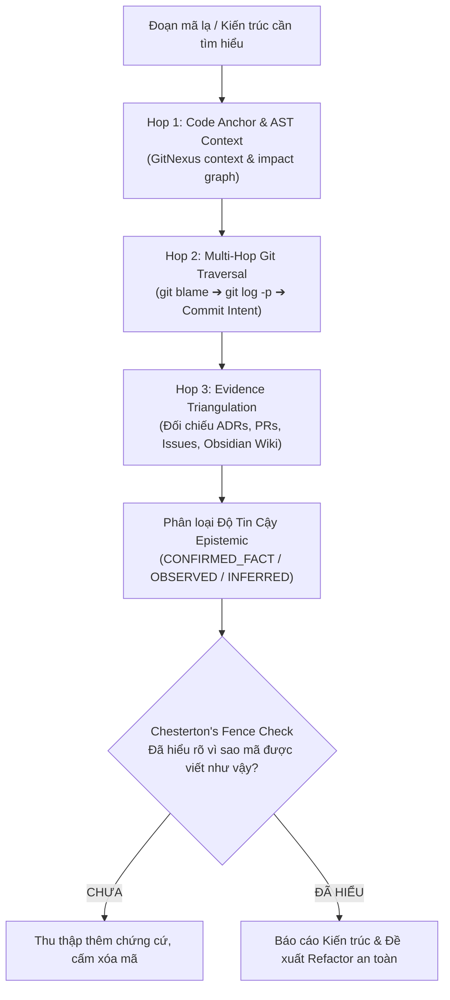

# Skill: /why — Khảo Cổ Học Kiến Trúc & Khung Nhận Thức Epistemics

Hệ thống hóa sự hiểu biết sâu sắc về mã nguồn trước khi thay đổi bằng mô hình **Epistemics Multi-Hop Agentic RAG**: truy vết lý do lịch sử, mục đích thiết kế nguyên bản và bảo vệ các quyết định kiến trúc qua nguyên lý Hàng Rào Chesterton.

> **Ranh giới Hợp đồng & Phân định với Systematic Debugging / Forensics:**
> - `/why` chuyên trách: Khảo cổ học quyết định kiến trúc lịch sử (Epistemics RAG, Chesterton's Fence, ADRs, PR rationale) nhằm trả lời câu hỏi *"Tại sao đoạn code/kiến trúc này lại được viết như vậy?"* trước khi thay đổi.
> - Khác với `/systematic-debugging` (sửa bug chức năng) và `/forensics` (truy vết lỗi ngầm/regression), `/why` bảo vệ các giả định kiến trúc ban đầu không bị phá hủy bừa bãi.

---

## Khung Nhận Thức 4 Bước Epistemics RAG

### Bước 1: Code Anchor & AST Context (Định vị Ký hiệu)
- Neo chính xác ký hiệu, hàm hoặc cấu trúc dữ liệu cần điều tra.
- Sử dụng GitNexus để lập sơ đồ phụ thuộc: hàm này nhận dữ liệu từ đâu, phụ thuộc vào module nào và tác động đến thành phần nào.

### Bước 2: Multi-Hop Git Traversal (Khảo Cổ Lịch Sử Đa Chặng)
- **Hop 1 (Anchor Blame):** Chạy `git blame -w -L <start>,<end> <file>` để xác định commit gần nhất tác động vào từng dòng mã.
- **Hop 2 (Evolution Traversal):** Sử dụng `git log --follow -p -n 5 <file>` để bóc tách tiến trình tiến hóa của file mã nguồn (ai đã đổi tên file, tái cấu trúc hàm, chuyển đổi kiểu dữ liệu).
- **Hop 3 (Intent Extraction):** Trích xuất commit message, tên nhánh (branch name), hoặc liên kết Pull Request để tìm câu trả lời cho câu hỏi: *Vấn đề cấp bách nào đã buộc lập trình viên phải viết đoạn code này?*

### Bước 3: Epistemic Evidence Triangulation (Tam Giác Hóa Bằng Chứng)
Đối chiếu chéo qua 7 nhóm nguồn chứng cứ thực tế:
1. **Git & PRs:** Commit messages, reviewer comments, diff ngữ cảnh.
2. **Architecture Decision Records (ADRs):** Các tài liệu kiến trúc trong `docs/` hoặc `F:\Obsidian\wiki\`.
3. **Issue Trackers & Bug Tickets:** Bối cảnh khách hàng hoặc lỗi production kích hoạt thay đổi.
4. **Chat & Meeting Notes:** Ghi chú trong Second Brain (`sources/` hoặc `wiki/`).
5. **Observability & Logs:** Các sự kiện runtime trong quá khứ liên quan đến module.
6. **Code Comments & Docstrings:** Các ghi chú kỹ thuật sẵn có trong mã nguồn.
7. **Test Cases:** Các ca kiểm thử được viết kèm theo (thường tiết lộ edge-case bí ẩn).

### Bước 4: Epistemic Confidence Framework & Chesterton's Fence
Phân loại độ tin cậy của mọi phát hiện thành 3 mức nghiêm ngặt:
- `CONFIRMED_FACT`: Sự thật đã được xác thực 100% bằng chứng cứ vật lý (commit message rõ ràng, test case chứng minh lý do, ADR phê duyệt).
- `OBSERVED_BEHAVIOR`: Hành vi quan sát thấy trong code nhưng chưa tìm được tài liệu xác nhận chủ đích.
- `INFERRED_HYPOTHESIS`: Giả thuyết do AI suy luận logic từ cấu trúc mã (bắt buộc phải ghi rõ nhãn này).

> **Nguyên tắc Bất Biến — Chesterton's Fence:**  
> *"Đừng bao giờ phá bỏ một hàng rào cho đến khi bạn biết chắc chắn lý do vì sao nó được dựng lên."*  
