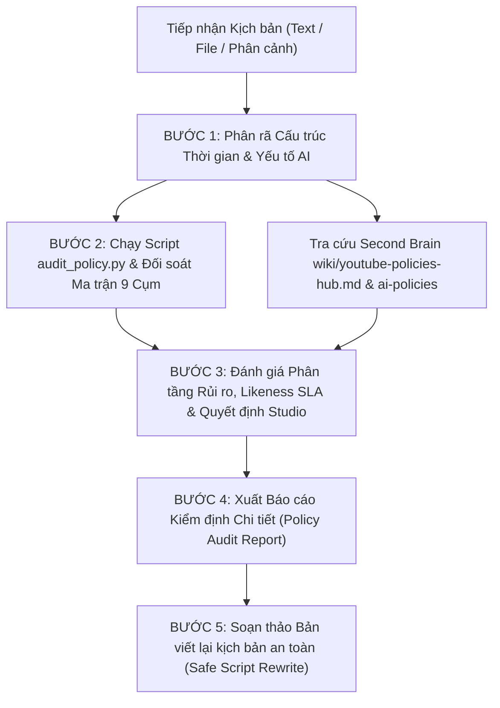

# YouTube Policy Auditor Skill (`/check-youtube-policy`)

Kỹ năng hỗ trợ sàng lọc rủi ro kịch bản trước sản xuất. Tích hợp động cơ quét heuristic regex cục bộ kết hợp bộ ma trận 9 cụm chính sách và kho tri thức **Second Brain Vault** (`F:\Obsidian\wiki\youtube-policies-hub.md`). Script hỗ trợ phát hiện sớm các từ khóa nhạy cảm, bạo lực 7s đầu, liên kết ngoài độc hại, dấu hiệu AI sản xuất hàng loạt và cảnh báo bắt buộc công bố nội dung AI / bảo vệ quyền riêng tư sinh trắc học (Likeness Protection). Checker độc lập phải đối soát ngữ cảnh thực tế; script không tự chứng nhận quyết định của YouTube.

---

## 1. NGUỒN TRI THỨC NỀN TẢNG & KHO SECOND BRAIN (KNOWLEDGE BASE)

Toàn bộ logic kiểm định được neo chặt vào hệ thống tri thức Second Brain Vault tại `F:\Obsidian\wiki\` và 5 tài liệu tham chiếu đóng gói tại `references/`:

### Kết nối Second Brain Wiki:
- **Trung tâm điều phối**: `[[youtube-policies-hub]]` — Bản đồ MOC chính sách YouTube toàn diện & mô hình 4Rs.
- **Trụ cột AI & Quyền riêng tư**: `[[youtube-ai-policies]]` — Tiêu chuẩn Chân thực, gắn nhãn Altered/Synthetic, C2PA, Likeness Protection (48h SLA).
- **Kiếm tiền & Quảng cáo**: `[[youtube-kiem-tien-va-ypp]]` & `[[youtube-noi-dung-phu-hop-nha-quang-cao]]` — Chuẩn Đô la Xanh vs Vàng, quy tắc 7s/15s.
- **Bản quyền & Khiếu nại**: `[[youtube-ban-quyen-va-content-id]]` — Content ID claim vs DMCA strike, Fair Use.
- **Nguyên tắc cộng đồng**: `[[youtube-nguyen-tac-cong-dong-va-noi-dung-nhay-cam]]` — Nhạy cảm, bạo lực, vũ khí, EDSA.
- **Spam & Dẫn link ngoài**: `[[youtube-thong-tin-sai-lech-spam-va-tuong-tac-gia]]` — Liên kết ngoài độc hại, giật tít lừa đảo.
- **An toàn trẻ em & Gia đình**: `[[youtube-chinh-sach-tre-em-va-gia-dinh]]` — COPPA, 18+.
- **Xử phạt & Kháng nghị**: `[[youtube-xu-phat-canh-cao-va-khang-nghi]]` — Hệ thống 3 gậy, form kháng nghị.

### 5 Tài liệu tham chiếu cốt lõi tại `references/`:
> ⚠️ **Bản crawl thô 50 tệp chính sách KHÔNG được đóng gói trong repo này.** Ma trận là bản hệ thống hoá từ các tài liệu gốc kết hợp Second Brain Vault.
> Vì vậy mọi kết luận phải dựa trên nội dung ma trận và wiki, không được giả định có bản gốc để tra cứu thêm.
>
> **Ràng buộc trích dẫn (BẮT BUỘC):** chỉ được viện dẫn mã chính sách / đường dẫn trợ giúp **có thật trong `references/policy_rules_matrix.md` hoặc `references/ai_policies_matrix.md`**.
> Nếu kịch bản chạm chủ đề không có trong ma trận → ghi rõ *"chủ đề này ngoài phạm vi dữ liệu của skill, cần kiểm tra thủ công trên Trung tâm trợ giúp YouTube"*, **KHÔNG tự sinh mã chính sách**.

1. `references/policy_rules_matrix.md`: Ma trận đối soát 9 cụm chính sách cốt lõi của YouTube.
2. `references/ai_policies_matrix.md`: Ma trận chi tiết chính sách AI, gắn nhãn Synthetic, C2PA và Likeness Claims.
3. `references/advertiser_guidelines.md`: Quy chuẩn kiếm tiền Đô la Xanh, quy tắc 7 giây đầu, phân loại bạo lực & thô tục.
4. `references/edsa_framing_guide.md`: 3 trụ cột EDSA và các mẫu Disclaimer chuẩn mực cứu cánh kịch bản gai góc.
5. `references/safe_vocabulary_dictionary.md`: Từ điển hoán đổi từ ngữ "tử thần" sang từ ngữ an toàn (Euphemisms).

> **Ràng buộc trích dẫn (BẮT BUỘC):** Chỉ viện dẫn mã chính sách / đường dẫn trợ giúp **có thật trong `references/policy_rules_matrix.md` hoặc `references/ai_policies_matrix.md`**. Nếu kịch bản chạm chủ đề ngoài ma trận → ghi rõ *"chủ đề này ngoài phạm vi dữ liệu của skill, cần kiểm tra thủ công trên Trung tâm trợ giúp YouTube"*, **KHÔNG tự sinh mã chính sách giả**.

### 9 Cụm Chính sách cốt lõi được đối soát:
1. **`01_Kiem_Tien_Va_YPP`**: Chính sách kiếm tiền kênh (`1311392`), Nguyên tắc nội dung phù hợp với nhà quảng cáo (`6162278`), Kiếm tiền Shorts (`12504220`), Tắt kiếm tiền (`1727191`), Biểu tượng kiếm tiền (`9208564`).
2. **`02_Ban_Quyen_Va_Content_ID`**: Bản quyền YouTube (`2797466`), Đơn kiện bản quyền DMCA (`6013276`), Fair Use.
3. **`03_Nguyen_Tac_Cong_Dong_Chung`**: Nguyên tắc cộng đồng (`9288567`), Trách nhiệm của nhà sáng tạo (`7650329`), Lưu ý về nguyên tắc (`10767342`).
4. **`04_Noi_Dung_Nhay_Cam_Va_Bao_Luc`**: Ngôn từ thô tục (`10072685`), Lời nói hận thù (`2801939`), Nội dung gây hại/nguy hiểm (`2801964`), Ảnh khỏa thân & tình dục (`2802002`), Bạo lực phản cảm (`2802008`), Tự tử & tự hại (`2802245`), Quấy rối bắt nạt (`2802268`), Súng cầm tay (`7667605`), Tổ chức tội phạm (`9229472`).
5. **`05_Thong_Tin_Sai_Lech_Va_Spam`**: Thông tin y tế sai lệch (`13813322`), Sai lệch bầu cử (`10835034`), Spam & lừa đảo (`2801973`), Đường link ngoài (`9054257`), Hàng hóa bất hợp pháp (`9229611`), Mạo danh (`2801947`), Tương tác ảo (`3399767`).
6. **`06_Tre_Em_Va_Gia_Dinh`**: An toàn trẻ em (`2801999`), Quy chuẩn COPPA (`9528076`), Giới hạn độ tuổi 18+ (`2802167`), Thực hành tốt cho trẻ em (`10774223`).
7. **`07_Xu_Phat_Canh_Cao_Va_Ho_Tro`**: Chấm dứt kênh (`2802168`), Báo cáo vi phạm (`2802027`), Vô hiệu hóa tài khoản (`40695`), Creator Support (`6249136`).
8. **`08_Chinh_Sach_Bo_Sung`**: Ngoại lệ EDSA (`6345162`), Hình thu nhỏ Thumbnail (`9229980`), Thông tin sai lệch chung (`10834785`), Chính sách AdSense (`48182`).
9. **`09_Tri_Tue_Nhan_Tao_Va_Danh_Tinh_So`**: Công bố nội dung AI Altered/Synthetic (`14328491`), Likeness Protection & Claims (`16440338`, `17133929`), Cấm AI sản xuất hàng loạt & Avatar AI tư vấn nhạy cảm (`1311392`), Xác thực C2PA (`15446725`).

---

## 2. QUY TRÌNH KIỂM ĐỊNH 5 BƯỚC KHÉP KÍN (5-STEP CLOSED-LOOP PROTOCOL)

Khi nhận kịch bản hoặc yêu cầu kiểm tra chính sách, bạn PHẢI thực hiện chu trình sau:



### BƯỚC 1: PHÂN RÃ CẤU TRÚC THỜI GIAN & YẾU TỐ AI (TIMELINE & AI FACTOR DECOMPOSITION)
- **Tách riêng 7 giây đầu tiên (Words 1 – 20)**: "Vùng tử thần" của bộ phân loại quảng cáo tự động. Rà soát tuyệt đối sạch từ ngữ thô tục nặng, bạo lực máu me, vũ khí, cảnh gợi dục.
- **Tách riêng 30 giây đầu tiên (Words 21 – 80)**: Vùng thiết lập bối cảnh. Bắt buộc có Disclaimer ngoại lệ EDSA nếu kịch bản khai thác chủ đề nhạy cảm/gai góc.
- **Rà soát yếu tố AI & Giọng đọc**:
  + Có sử dụng giọng đọc AI nhân bản người thật nổi tiếng hoặc hoán đổi khuôn mặt không? $\rightarrow$ Rủi ro Likeness Claim (SLA 48h).
  + Có mô phỏng tai nạn, thảm họa, sự kiện thời sự giả lập chân thực không? $\rightarrow$ Bắt buộc chuẩn bị gắn nhãn Altered Content.
  + Kịch bản có dấu hiệu rập khuôn mẫu AI máy móc (AI programmatic slop) không? $\rightarrow$ Nguy cơ dính lỗi Repetitious Content khi duyệt YPP.
- **Phần kết & Kêu gọi hành động (Outro & CTA) & Metadata**: Rà soát link Telegram kéo nhóm tài chính/cá cược (vi phạm 9054257), link rút gọn mờ ám, giật tít lừa đảo (clickbait).

### BƯỚC 2: CHẠY CÔNG CỤ QUÉT TỰ ĐỘNG & ĐỐI SOÁT MA TRẬN
- Kích hoạt script kiểm tra tự động qua CLI:
  ```bash
  # Quét từ file kịch bản (.txt, .md):
  python plugins/marketing/skills/check-youtube-policy/scripts/audit_policy.py --file path/to/script.md

  # Quét trực tiếp từ chuỗi text:
  python plugins/marketing/skills/check-youtube-policy/scripts/audit_policy.py --text "<nội_dung_kịch_bản>"
  ```
- Đối soát chéo với các tài liệu tham chiếu:
  * `references/policy_rules_matrix.md`: Kiểm tra 9 cụm chính sách.
  * `references/ai_policies_matrix.md`: Đối soát tiêu chuẩn gắn nhãn AI và bảo vệ danh tính.
  * `references/advertiser_guidelines.md`: Đối soát điều kiện Đô la Xanh vs Đô la Vàng.
  * `references/edsa_framing_guide.md`: Lựa chọn mẫu Disclaimer EDSA phù hợp.
  * `references/safe_vocabulary_dictionary.md`: Tra cứu từ ngữ thay thế an toàn.

### BƯỚC 3: ĐÁNH GIÁ PHÂN TẦNG RỦI RO, LIKENESS SLA & CHECKBOX STUDIO
- **Điểm số Heuristic**: Điểm quy ước từ regex (0-100), phản ánh mức độ tập trung từ khóa nhạy cảm.
- **Thiết lập YouTube Studio khi tải lên**:
  + **Nội dung đã qua chỉnh sửa (AI)**: Xác định BẮT BUỘC TICK "CÓ" hay KHÔNG CẦN TICK.
  + **Giới hạn độ tuổi 18+**: Xác định có cần bật 18+ để bảo vệ kênh khỏi gậy cộng đồng.
  + **Dành cho trẻ em (COPPA)**: Chọn "Không, đây không phải nội dung dành cho trẻ em".
  + **Likeness Claim Risk**: Nhận diện rủi ro bị chủ thể khiếu nại trong 48 giờ.

### BƯỚC 4: XUẤT BÁO CÁO KIỂM ĐỊNH CHI TIẾT (POLICY AUDIT REPORT)
Xuất báo cáo theo định dạng chuẩn hóa 6 phần (xem Mục 3 dưới đây).

### BƯỚC 5: SOẠN THẢO BẢN VIẾT LẠI KỊCH BẢN AN TOÀN (SAFE SCRIPT REWRITE)
- **Nguyên tắc viết lại**:
  * Giữ trọn vẹn thông điệp và sức hút của kịch bản gốc.
  * Thay thế 100% từ ngữ nguy hiểm bằng từ vựng an toàn (Euphemisms) theo Từ điển.
  * Cấy câu Disclaimer tuyên bố mục đích giáo dục/phòng ngừa tội phạm (EDSA) vào 5 giây đầu tiên.
  * Tinh chỉnh câu thoại gay gắt thành ngôn ngữ đấu trí, phóng sự điều tra hoặc chỉ định rõ hiệu ứng âm thanh: `[Lồng tiếng: Tiếng BEEP]`.

---

## 3. CẤU TRÚC BÁO CÁO KIỂM ĐỊNH CHUẨN HÓA (OUTPUT FORMAT)

Khi trả kết quả cho Sếp, báo cáo BẮT BUỘC tuân thủ định dạng markdown sau:

```markdown
# 📋 BÁO CÁO KIỂM ĐỊNH CHÍNH SÁCH YOUTUBE: [TÊN KỊCH BẢN / CHỦ ĐỀ]

## 1. BẢNG TỔNG QUAN ĐIỂM SỐ & DỰ BÁO TRẠNG THÁI
| Chỉ số kiểm tra | Kết quả đánh giá | Diễn giải kỹ thuật của Trọng tài |
|:---|:---:|:---|
| **Điểm sàng lọc heuristic** | **[Điểm số]/100** | [Điểm quy ước regex; không chứng nhận] |
| **Tín hiệu rủi ro** | [Chưa phát hiện / MEDIUM / HIGH / CRITICAL] | [Ngữ cảnh cần kiểm tra] |
| **Kiếm tiền/YPP/bản quyền** | **NOT_VERIFIED** | [Cần bản dựng, giấy phép và đánh giá của YouTube] |
| **Quy mô Kịch bản** | [Số từ] từ | Ước tính thời lượng giọng đọc: [Số phút] phút |
| **Bối cảnh Ngoại lệ EDSA** | [✅ Đã có / ❌ Chưa có Disclaimer] | Căn cứ Chính sách EDSA (ID: 6345162) |
| **Phát hiện Vi phạm** | [Tổng số] điểm | 🔴 Critical: [x] | 🟠 High: [y] | 🟡 Medium: [z] |

---

## 2. CHECKBOX THIẾT LẬP YOUTUBE STUDIO KHI TẢI LÊN
| Mục thiết lập trong YouTube Studio | Quyết định đề xuất | Hướng dẫn & Căn cứ chính sách |
|:---|:---:|:---|
| **Nội dung đã qua chỉnh sửa (AI)** | **[BẮT BUỘC TICK 'CÓ' / KHÔNG CẦN]** | [Căn cứ Chính sách 14328491 & Tiêu chuẩn Chân thực] |
| **Giới hạn độ tuổi (18+)** | **[KHUYẾN NGHỊ BẬT 18+ / KHÔNG CẦN]** | [Bảo vệ kênh khỏi gậy vi phạm bạo lực/người lớn] |
| **Dành cho trẻ em (COPPA)** | **CHỌN 'KHÔNG'** | [Tuân thủ đạo luật COPPA (ID: 9528076)] |
| **Rủi ro Likeness Protection** | **[CẢNH BÁO / AN TOÀN]** | [Quy trình xử lý 48h SLA nếu mô phỏng người thật] |

---

## 3. BẢNG ĐỐI SOÁT CHI TIẾT CÁC LỖI VI PHẠM
| STT | Vị trí xuất hiện | Câu trích dẫn trong kịch bản | Chính sách vi phạm (Kèm ID Google) | Cấp độ rủi ro | Cơ chế quét của AI YouTube & Hướng khắc phục |
|:---:|:---|:---|:---|:---:|:---|
| 1 | [Vị trí thời gian] | `"[Câu gốc]"` | [Tên chính sách vi phạm] (ID: `[Mã_ID]`) | [🔴/🟠/🟡] | [Giải thích thuật toán bắt lỗi & Hướng dẫn sửa] |

---

## 4. BẢNG HOÁN ĐỔI TỪ NGỮ AN TOÀN (SAFE VOCABULARY MAPPING)
| Từ khóa gốc vi phạm | Từ ngữ thay thế an toàn đề xuất | Lý do chuyển đổi ngữ nghĩa |
|:---|:---|:---|
| `[Từ khóa gốc]` | **[Mô tả trung lập đề xuất]** | [Giảm rủi ro bộ lọc AI; bảo vệ ngữ cảnh an toàn] |

---

## 5. MẪU TUYÊN BỐ MIỄN TRỪ TRÁCH NHIỆM EDSA ĐỀ XUẤT
> **[DISCLAIMER - CHÈN VÀO 0s - 5s ĐẦU TIÊN HOẶC GHIM ĐẦU DESCRIPTION]**:  
> *"[Nội dung câu Disclaimer mẫu phù hợp nhất với thể loại kịch bản]"*

---

## 6. BẢN KỊCH BẢN HOÀN CHỈNH ĐÃ ĐƯỢC CHUẨN HÓA (SAFE SCRIPT REWRITE)
*(Bản nháp do Creator chỉnh sửa để triệt tiêu rủi ro chính sách; cần Checker độc lập thẩm định lại trước khi sản xuất.)*

[Toàn văn kịch bản an toàn đã thay thế từ ngữ, cấy Disclaimer và ghi chú hậu kỳ...]

---

## 7. GIỚI HẠN & THẨM ĐỊNH TIẾP THEO
- Heuristic regex chỉ quét văn bản kịch bản; không đánh giá video dựng thực tế, hiệu ứng hình ảnh, nhạc nền hoặc bản quyền âm thanh Content ID.
- Việc đổi từ hoặc chèn Disclaimer chỉ hỗ trợ phân loại EDSA, không đảm bảo 100% video sẽ được bật kiếm tiền Đô la Xanh.
- Luôn kiểm tra đối soát với Trung tâm trợ giúp YouTube và Second Brain Wiki `[[youtube-policies-hub]]` đối với các trường hợp tranh chấp phức tạp.
```

---

## 4. HƯỚNG DẪN KÍCH HOẠT NHANH BẰNG CÔNG CỤ TỰ ĐỘNG

Bạn có thể kích hoạt script kiểm tra nhanh bất kỳ lúc nào qua `run_command`:

```bash
# Quét kịch bản từ file text / markdown:
python plugins/marketing/skills/check-youtube-policy/scripts/audit_policy.py --file path/to/script.md

# Quét kịch bản trực tiếp từ chuỗi ký tự:
python plugins/marketing/skills/check-youtube-policy/scripts/audit_policy.py --text "Kịch bản cần check..."

# Xuất dữ liệu cấu trúc dạng JSON:
python plugins/marketing/skills/check-youtube-policy/scripts/audit_policy.py --file path/to/script.md --json
```

---

## 5. Route trước khi làm — khi nào KHÔNG dùng skill này

| Yêu cầu thực ra là | Dùng skill |
|---|---|
| Viết kịch bản video mới cho kênh Bóc Phốt Tài Chính | `boc-phot-storytelling` |
| Phân tích kênh đối thủ YouTube (số liệu, outlier) | `yt-competitor-analyzer` |
| Viết content bán hàng / caption quảng cáo | `cong-thuc-viet-content-by-noti-v4` |
| Tối ưu SEO / AEO / GEO cho bài viết | `viet-content-seo-geo-v5` |

## Đối chiếu tuân thủ trước khi trả bản final (BẮT BUỘC)

Trước khi giao bản cuối, tự rà theo `rubrics/content_compliance_rubric.md` — 4 trụ cột:  
**(1)** Tuân thủ chính sách nền tảng · **(2)** Quét sạch sáo rỗng AI (anti-slop) · **(3)** Kiểm chứng dữ liệu & logic · **(4)** Cấu trúc chuyển đổi & sức hút.  
Chạy ở chế độ closed-loop thì Compliance Critic sẽ thẩm định lại và ra phán quyết — skill này không tự phê duyệt.
