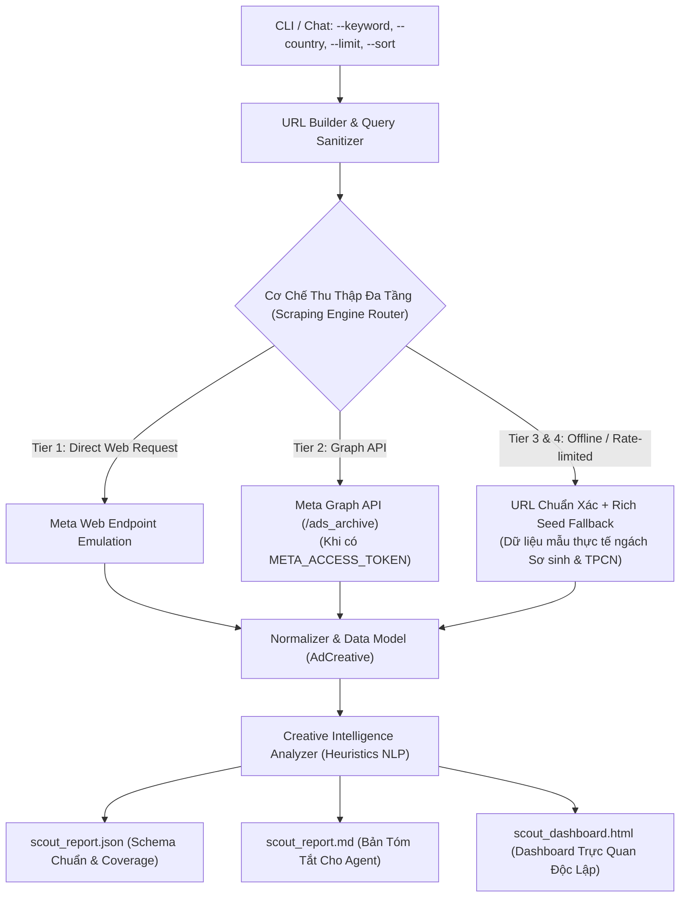

# Meta Ads Scout Skill (`/meta-ad-scout`)

Kỹ năng trinh sát chuyên sâu Meta Ads Library (Thư viện quảng cáo Facebook) theo từ khóa chủ đề (ví dụ: `"sơ sinh"`, `"thực phẩm chức năng"`), bóc tách các mẫu quảng cáo đang được phân phối mạnh nhất, tự động nhận diện chiến dịch vít ngân sách khủng (Winning Ads), phân tích góc tiếp cận tâm lý (Hook / Offer / Angle) và xuất bản Dashboard trực quan chuẩn Apple Dark Glassmorphism.

---

## 1. Kiến Trúc Thu Thập Đa Tầng (Multi-Tier Scraping Architecture)



### Nguyên Tắc Bất Biến Về Dữ Liệu & Fallback
1. **Không bao giờ crash:** Nếu Meta chặn IP (HTTP 429) hoặc yêu cầu Captcha, hệ thống tự động fallback về Tier 3/4: Trả về link trực tiếp Meta Ads Library đã được tối ưu tham số tìm kiếm chính xác + nạp bộ dữ liệu Seed mẫu phong phú để không gián đoạn tiến trình của Agent.
2. **Không ảo giác số liệu:** Bất kỳ chỉ số nào Meta ẩn hoặc không cung cấp đều được gán `N/A` hoặc `null`. Trường `CoverageMetrics` phản ánh trung thực số lượng `requested`, `collected`, `failed`.
3. **An toàn bảo mật & XSS:** Toàn bộ nội dung văn bản từ quảng cáo được escape an toàn bằng `html.escape()`. URL media chỉ chấp nhận giao thức `http://` hoặc `https://`.

---

## 2. Cú Pháp Dòng Lệnh (CLI Reference)

Kỹ năng vận hành thông qua script trung tâm `scripts/meta_ads_scout.py`:

```bash
python scripts/meta_ads_scout.py \
  --keyword "sơ sinh" \
  --country VN \
  --limit 20 \
  --sort total_impressions \
  --active-only \
  --format all \
  --output-dir output/meta_scout
```

### Các Tham Số Chính:
| Tham Số | Viết Tắt | Mặc Định | Ý Nghĩa Kỹ Thuật |
| :--- | :---: | :---: | :--- |
| `--keyword` | `-k` | `"sơ sinh"` | Từ khóa cần trinh sát (tự động bọc nháy kép để tìm chính xác cụm từ). |
| `--country` | `-c` | `VN` | Mã quốc gia 2 ký tự ISO Alpha-2 (ví dụ: `VN`, `US`, `TH`). |
| `--limit` | `-l` | `20` | Giới hạn số lượng mẫu quảng cáo cần cào. |
| `--sort` | — | `total_impressions` | Sắp xếp theo: `total_impressions`, `relevance`, `start_date`. |
| `--min-days` | — | `14` | Ngưỡng số ngày chạy liên tục để xác định Winning Ad. |
| `--media-type` | — | `all` | Lọc theo loại media: `all`, `image`, `video`. |
| `--active-only` | — | `True` | Chỉ lấy quảng cáo đang hoạt động (`active_status=active`). |
| `--format` | — | `all` | Định dạng xuất: `json`, `md`, `html`, hoặc `all`. |
| `--output-dir` | `-o` | `./output` | Thư mục lưu trữ kết quả. |
| `--seed` | — | `False` | Kích hoạt chế độ Offline Demo tức thì bằng dữ liệu mẫu. |
| `--no-analyze` | — | `False` | Bỏ qua phân tích AI Hook/Angle nếu chỉ lấy dữ liệu thô. |
| `--json` | — | `False` | Xuất kết quả dạng JSON ra màn hình stdout. |

---

## 3. Quy Chuẩn Bóc Tách Góc Tiếp Cận (Creative Angle Taxonomy)

Hệ thống tự động phân loại từng mẫu quảng cáo vào các chiều tâm lý:

1. **Phân loại Hook (Hook Type):**
   - *Nỗi sợ & Cảnh báo (Fear / Problem-Agitate):* Chạm vào nỗi sợ, sai lầm phổ biến, rủi ro sức khỏe.
   - *Tò mò & Đặt câu hỏi (Curiosity / Question):* Sử dụng câu hỏi gợi mở, hé lộ bí mật ngành.
   - *Khuyến mãi & Ưu đãi (Promotion / Offer-driven):* Tập trung vào giảm giá %, quà tặng combo, freeship.
   - *Bằng chứng xã hội (Social Proof / Authority):* Viện dẫn lời khuyên bác sĩ, số lượng khách hàng tin dùng.
   - *Lợi ích vượt trội (Benefit-driven):* Làm nổi bật kết quả, sự thoải mái và tiện lợi.

2. **Nhận diện Winning Ads (Đang Vít Khủng):**
   - Một mẫu quảng cáo được gắn nhãn **🔥 ĐANG VÍT KHỦNG** khi thỏa mãn:
     + Chạy liên tục từ **14 ngày trở lên** (`days_active >= 14`), HOẶC
     + Được nhân bản chạy trên **3 nhóm quảng cáo trở lên** (`variant_count >= 3`).

3. **Bóc tách Ưu đãi (Primary Offer):**
   - Trích xuất tự động: Combo quà tặng, mã giảm giá, Freeship toàn quốc, chính sách bảo hành.

---

## 4. Đặc Điểm Giao Diện Dashboard HTML

Dashboard độc lập được thiết kế theo phong cách **Apple Dark Glassmorphism**:
- **KPI Summary Cards:** Thống kê tổng số mẫu quét được, số lượng mẫu đang vít khủng, tỷ lệ hoàn tất.
- **Bespoke Feed Card:** Mô phỏng thẻ tin Facebook Feed thực tế kèm avatar Fanpage, ngày bắt đầu chạy, huy hiệu nền tảng (Facebook/Instagram/Messenger).
- **VIP Scaling Badge:** Huy hiệu viền cam phát sáng cho các mẫu quảng cáo chiến thắng.
- **1-Click Copy Copy-Ads:** Nút bấm sao chép nhanh toàn bộ nội dung bài viết quảng cáo vào clipboard để media buyers và copywriters tái sử dụng.
- **Bộ lọc thời gian thực:** Lọc tức thì theo Video, Ảnh tĩnh, hoặc chỉ xem các mẫu Đang Vít Khủng.

---

## 5. Quy Trình Phối Hợp Tác Tử Trong Chat (Agent Workflow)

Khi Sếp yêu cầu: *"Quét các mẫu ads đối thủ đang vít mạnh ngành sơ sinh"*
1. **Web Researcher:** Gọi `python scripts/meta_ads_scout.py --keyword "sơ sinh" --format all --output-dir .brain/scout_so_sinh`.
2. **Creator (Maker):** Đọc file `scout_report.json` và `scout_report.md`, lọc ra top 3 winning angles để xây dựng kịch bản video hoặc dàn ý bài viết mới.
3. **Compliance Critic:** Đối soát tính trung thực của các trích dẫn và link snapshot trước khi nghiệm thu bàn giao cho Sếp.
