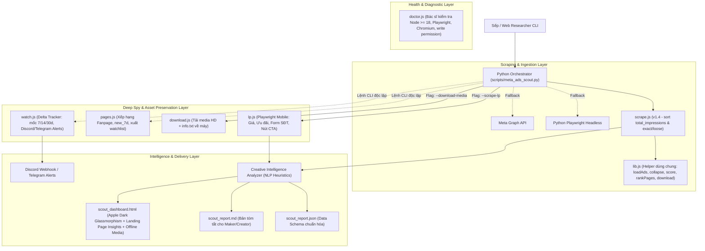

# Meta Ads Scout Skill (`/meta-ad-scout`) — v2.0

Kỹ năng trinh sát chuyên sâu Meta Ads Library (Thư viện quảng cáo Facebook) theo từ khóa chủ đề (ví dụ: `"sơ sinh"`, `"thực phẩm chức năng"`, `"sữa hạt"`), bóc tách các mẫu quảng cáo đang được phân phối mạnh nhất, tự động nhận diện chiến dịch vít ngân sách khủng (Winning Ads), soi Landing Page di động (Mobile Landing Page Spy), tải offline trọn bộ Creative tránh link CDN hết hạn, xếp hạng Fanpage đối thủ, và giám sát định kỳ theo Watchlist.

---

## 1. Kiến Trúc Tích Hợp Toàn Diện (Hybrid Architecture v2.0)

Kỹ năng kết hợp **Python Orchestrator** với bộ công cụ chuyên dụng **Node.js Playwright Tools**:



---

## 2. Bộ Công Cụ Node.js Bổ Trợ (`plugins/marketing/tools/ad-library/`)

Tất cả các công cụ Node.js đều tự động xác định thư mục gốc workspace thông qua `lib.getProjectRoot()`, khóa cứng UTF-8 và bảo vệ Process Hygiene.

| Script | Mô Tả Chức Năng | Ví Dụ Lệnh Thực Thi |
| :--- | :--- | :--- |
| `doctor.js` | Khám sức khỏe môi trường Node.js $\ge 18$, Playwright, Chromium | `node plugins/marketing/tools/ad-library/doctor.js` |
| `scrape.js` | Cào trực tiếp Meta Ads Library qua Playwright, hỗ trợ `--sort top\|new` | `node plugins/marketing/tools/ad-library/scrape.js --q "sữa hạt" --max 50 --sort top` |
| `rank.js` | Xếp hạng ad thắng từ nhiều file JSON, phát hiện ad đang test (`--test-variants`) | `node plugins/marketing/tools/ad-library/rank.js output/*.json --top 15 --min-days 7` |
| `pages.js` | Xếp hạng Fanpage đối thủ, đo chỉ số scale `new_7d`, xuất file watchlist | `node plugins/marketing/tools/ad-library/pages.js output/*.json --top 10 --watchlist` |
| `download.js` | Tải trọn bộ media (ảnh, video, preview) về ổ cứng kèm `info.txt` | `node plugins/marketing/tools/ad-library/download.js output/*.json --top 5` |
| `lp.js` | Giả lập mobile soi landing page: giá, ưu đãi, form chốt SĐT, nút bấm | `node plugins/marketing/tools/ad-library/lp.js output/*.json --top 5` |
| `watch.js` | Giám sát định kỳ theo `watchlist.json`, gửi cảnh báo Discord/Telegram | `node plugins/marketing/tools/ad-library/watch.js --dry-run` |

---

## 3. Cú Pháp Dòng Lệnh Python Orchestrator (`scripts/meta_ads_scout.py`)

Lệnh điều phối toàn diện một chạm:
```bash
python scripts/meta_ads_scout.py \
  --keyword "sữa hạt" \
  --limit 20 \
  --sort total_impressions \
  --scrape-lp \
  --download-media \
  --format all \
  --output-dir output/sua_hat
```

### Bảng Tham Số Dòng Lệnh Mở Rộng:
| Tham Số | Viết Tắt | Mặc Định | Ý Nghĩa Kỹ Thuật |
| :--- | :---: | :---: | :--- |
| `--keyword` | `-k` | `"sơ sinh"` | Từ khóa cần trinh sát (mặc định tìm kiếm chính xác theo cụm từ). |
| `--country` | `-c` | `VN` | Mã quốc gia 2 ký tự ISO Alpha-2 (ví dụ: `VN`, `US`, `TH`). |
| `--limit` | `-l` | `20` | Số lượng mẫu quảng cáo cần cào (1 - 100). |
| `--sort` | — | `total_impressions` | Tiêu chí sắp xếp: `total_impressions` (vít ngân sách khủng), `new` (mới nhất), `relevance`. |
| `--loose` | — | `False` | Bật tìm kiếm mở rộng (tương đương `search_type=keyword_unordered`). |
| `--scrape-lp` | — | `False` | **Mới:** Tự động soi Landing Page bằng Playwright Mobile (giá, ưu đãi, form SĐT). |
| `--download-media` | — | `False` | **Mới:** Tự động tải media về ổ cứng và ưu tiên nhúng media cục bộ vào Dashboard. |
| `--min-days` | — | `14` | Ngưỡng số ngày chạy liên tục để xác định Winning Ad. |
| `--media-type` | — | `all` | Lọc theo loại media: `all`, `image`, `video`. |
| `--active-only` | — | `True` | Chỉ lấy quảng cáo đang hoạt động (`--no-active-only` để tắt). |
| `--cdp-port` | — | `None` | Cổng Chrome DevTools Protocol (ví dụ: `9222`) gắn vào Chrome thật có sẵn. |
| `--seed` | — | `False` | Chế độ Demo tức thì không cần kết nối mạng. |
| `--format` | — | `all` | Định dạng báo cáo xuất ra: `json`, `md`, `html`, `all`. |
| `--output-dir` | `-o` | `./output` | Thư mục lưu trữ kết quả. |

---

## 4. Hướng Dẫn Thiết Lập Giám Sát Định Kỳ & Task Scheduler trên Windows

### Bước 1: Khởi tạo danh sách theo dõi (`watchlist.json`)
Sử dụng file mẫu `plugins/marketing/tools/ad-library/watchlist.example.json` hoặc dùng lệnh `pages.js --watchlist` để tự động tạo `watchlist.json`:
```json
{
  "settings": {
    "country": "VN",
    "status": "active",
    "media": "all",
    "delay_seconds": 15,
    "discord_webhook": "https://discord.com/api/webhooks/...",
    "telegram": {
      "bot_token": "YOUR_BOT_TOKEN",
      "chat_id": "YOUR_CHAT_ID"
    }
  },
  "targets": [
    {
      "page_id": "100064829182341",
      "page_name": "Sữa Hạt Dinh Dưỡng Ovisure",
      "note": "Top đối thủ ngành sữa hạt"
    },
    {
      "keyword": "sữa hạt xương khớp",
      "note": "Từ khóa ngách trọng điểm"
    }
  ]
}
```

### Bước 2: Kiểm tra cấu hình trước khi chạy (Dry-run)
```bash
node plugins/marketing/tools/ad-library/watch.js --dry-run
```

### Bước 3: Đặt lịch chạy tự động hàng ngày bằng Windows Task Scheduler (`schtasks`)
Chạy lệnh PowerShell (Run as Administrator):
```powershell
schtasks /create /tn "MetaAdsScoutWatcher" /tr "node \"%CD%\plugins\marketing\tools\ad-library\watch.js\"" /sc daily /st 08:30 /f
```
> [!TIP]
> Để xóa lịch quét: `schtasks /delete /tn "MetaAdsScoutWatcher" /f`

---

## 5. Quy Trình Phối Hợp Trong Dynamic Marketing Triad

Khi người dùng yêu cầu: *"Trinh sát các đối thủ bán sữa hạt đang chạy mạnh trên Facebook"*
1. **Web Researcher:**
   - Chạy lệnh: `python scripts/meta_ads_scout.py --keyword "sữa hạt" --limit 15 --sort total_impressions --scrape-lp --download-media --output-dir output/sua_hat`.
   - Kết quả: Thu thập 15 ads, bóc tách Landing page (giá, ưu đãi, form SĐT), tải toàn bộ media HD về thư mục cục bộ và xuất Dashboard HTML.
2. **Creator / Maker:**
   - Đọc `scout_report.md` và `scout_report.json`.
   - Xem video/ảnh offline trong thư mục `output/creative/...`.
   - Bóc tách Hook 3s đầu, Angle tâm lý và Offer chuyển đổi của đối thủ để soạn thảo kịch bản phản đòn vượt trội.
3. **Compliance Critic:**
   - Rà soát các cam kết trị liệu (bệnh lý, xương khớp) của đối thủ.
   - Cảnh báo các từ khóa nhạy cảm vi phạm chính sách Meta Ads/YouTube YPP để Creator loại bỏ khỏi kịch bản mới.
