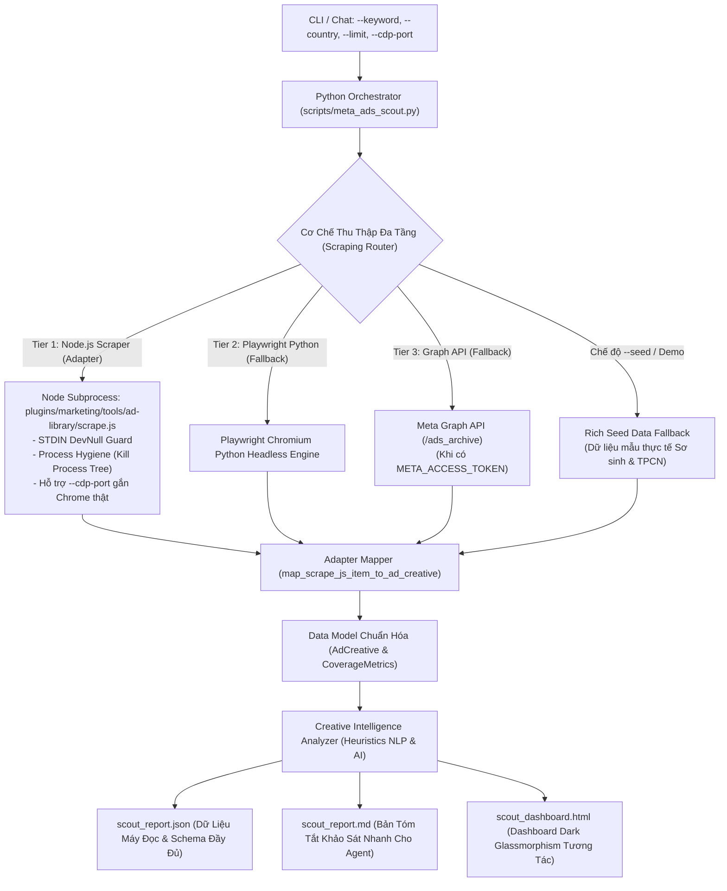

# Meta Ads Scout Skill (`/meta-ad-scout`)

Kỹ năng trinh sát chuyên sâu Meta Ads Library (Thư viện quảng cáo Facebook) theo từ khóa chủ đề (ví dụ: `"sơ sinh"`, `"thực phẩm chức năng"`), bóc tách các mẫu quảng cáo đang được phân phối mạnh nhất, tự động nhận diện chiến dịch vít ngân sách khủng (Winning Ads), phân tích góc tiếp cận tâm lý (Hook / Offer / Angle) và xuất bản Dashboard trực quan chuẩn Apple Dark Glassmorphism.

---

## 1. Kiến Trúc Lai Ghép & Thu Thập Đa Tầng (Hybrid Adapter Architecture)

Kỹ năng áp dụng **Kiến trúc Lai Ghép Subprocess - Adapter Pattern**: kết hợp sức mạnh phân tích NLP và điều phối pipeline của Python với tốc độ cào bóc tách GraphQL DOM của Node.js / Playwright.



### Nguyên Tắc Bất Biến Về Dữ Liệu & Process Hygiene
1. **Process & Browser Hygiene:** Toàn bộ tiến trình cào Node.js chạy với `stdin=subprocess.DEVNULL`. Cơ chế `kill_process_tree(pid)` tự động triệt tiêu toàn bộ cây tiến trình con (`node.exe`, `chrome.exe`) khi timeout hoặc phát sinh lỗi, loại bỏ hoàn toàn nguy cơ rò rỉ tiến trình mồ côi trên Windows.
2. **Graceful Fallback:** Tự động kiểm tra môi trường (`shutil.which('node')` và sự tồn tại của script). Nếu thiếu Node hoặc Node scraper thất bại, hệ thống tự động fallback mượt mà sang Playwright Python mà không crash.
3. **Cấm Hallucination Số Liệu:** Trường `CoverageMetrics` phản ánh trung thực số lượng mẫu thu thập được (`collected`, `requested`, `failed`, `missing_fields`).
4. **Bảo Mật & Safe Sanitization:** Mọi tham số dòng lệnh truyền sang subprocess được truyền dạng danh sách token độc lập (`shell=False`), triệt tiêu hoàn toàn rủi ro shell injection. Dữ liệu văn bản hiển thị trên HTML dashboard đều được escape an toàn qua `html.escape()`.

---

## 2. Cài Đặt Engine Node.js Phụ Trợ (Tùy Chọn Khuyên Dùng)

Để tối ưu hóa tốc độ cào và khả năng bóc tách gói tin GraphQL trực tiếp từ Meta Ads Library, hãy cài đặt dependencies cho module Node.js:

```bash
cd plugins/marketing/tools/ad-library
npm install
```
> [!NOTE]
> Lệnh `npm install` sẽ tự động kích hoạt `playwright install chromium`. Nếu máy tính chưa cài đặt Node.js hoặc bỏ qua bước này, hệ thống sẽ tự động dùng Playwright Python có sẵn mà không ảnh hưởng đến chức năng.

---

## 3. Cú Pháp Dòng Lệnh (CLI Reference)

Kỹ năng vận hành thông qua script trung tâm `scripts/meta_ads_scout.py`:

```bash
python scripts/meta_ads_scout.py \
  --keyword "sơ sinh" \
  --country VN \
  --limit 20 \
  --sort total_impressions \
  --active-only \
  --format all \
  --output-dir output/meta_scout
```

### Chế Độ Gắn Chrome Thật Bằng CDP Port (`--cdp-port`):
Khi mạng bị kiểm tra gắt gao hoặc Meta Ads Library yêu cầu vượt checkpoint/captcha, bạn có thể mở Google Chrome thật với cổng gỡ lỗi từ xa:
```bash
# Mở Chrome với cổng remote debugging (trên Windows PowerShell):
Start-Process "chrome.exe" -ArgumentList "--remote-debugging-port=9222"
```
Sau đó chạy lệnh scout với tham số `--cdp-port`:
```bash
python scripts/meta_ads_scout.py --keyword "sơ sinh" --cdp-port 9222
```
*Tác dụng:* Engine sẽ kết nối trực tiếp vào trình duyệt Chrome thật đang mở, tái sử dụng toàn bộ cookies và phiên đăng nhập, cào trơn tru mà không bị checkpoint và không đóng trình duyệt của người dùng sau khi hoàn thành.

### Bảng Tham Số Dòng Lệnh:
| Tham Số | Viết Tắt | Mặc Định | Ý Nghĩa Kỹ Thuật |
| :--- | :---: | :---: | :--- |
| `--keyword` | `-k` | `"sơ sinh"` | Từ khóa cần trinh sát (tự động bọc nháy kép để tìm chính xác cụm từ). |
| `--country` | `-c` | `VN` | Mã quốc gia 2 ký tự ISO Alpha-2 (ví dụ: `VN`, `US`, `TH`). |
| `--limit` | `-l` | `20` | Giới hạn số lượng mẫu quảng cáo cần cào (1 - 100). |
| `--sort` | — | `total_impressions` | Sắp xếp theo: `total_impressions`, `relevance`, `start_date`. |
| `--min-days` | — | `14` | Ngưỡng số ngày chạy liên tục để xác định Winning Ad. |
| `--media-type` | — | `all` | Lọc theo loại media: `all`, `image`, `video`. |
| `--active-only` | — | `True` | Chỉ lấy quảng cáo đang hoạt động (`active_status=active`). |
| `--cdp-port` | — | `None` | Cổng Chrome DevTools Protocol (ví dụ: `9222`) gắn vào Chrome thật có sẵn. |
| `--format` | — | `all` | Định dạng xuất: `json`, `md`, `html`, hoặc `all`. |
| `--output-dir` | `-o` | `./output` | Thư mục lưu trữ kết quả. |
| `--seed` | — | `False` | Kích hoạt chế độ Offline Demo tức thì bằng dữ liệu mẫu. |
| `--no-analyze` | — | `False` | Bỏ qua phân tích AI Hook/Angle nếu chỉ lấy dữ liệu thô. |
| `--json` | — | `False` | Xuất kết quả dạng JSON ra màn hình stdout. |

---

## 4. Quy Chuẩn Bóc Tách Góc Tiếp Cận (Creative Angle Taxonomy)

Hệ thống tự động phân loại từng mẫu quảng cáo vào các chiều tâm lý:

1. **Phân loại Hook (Hook Type):**
   - *Nỗi sợ & Cảnh báo (Fear / Problem-Agitate):* Chạm vào nỗi sợ, sai lầm phổ biến, rủi ro sức khỏe.
   - *Tò mò & Đặt câu hỏi (Curiosity / Question):* Sử dụng câu hỏi gợi mở, hé lộ bí mật ngành.
   - *Khuyến mãi & Ưu đãi (Promotion / Offer-driven):* Tập trung vào giảm giá %, quà tặng combo, freeship.
   - *Bằng chứng xã hội (Social Proof / Authority):* Viện dẫn lời khuyên bác sĩ, số lượng khách hàng tin dùng.
   - *Lợi ích vượt trội (Benefit-driven):* Làm nổi bật kết quả, sự thoải mái và tiện lợi.

2. **Nhận diện Winning Ads (Đang Vít Khủng):**
   - Một mẫu quảng cáo được gắn nhãn **🔥 ĐANG VÍT KHỦNG** khi thỏa mãn:
     + Chạy liên tục từ **14 ngày trở lên** (`days_active >= 14`), HOẶC
     + Được nhân bản chạy trên **3 nhóm quảng cáo trở lên** (`variant_count >= 3`).

3. **Bóc tách Ưu đãi (Primary Offer):**
   - Trích xuất tự động: Combo quà tặng, mã giảm giá, Freeship toàn quốc, chính sách bảo hành.

---

## 5. Đặc Điểm Giao Diện Dashboard HTML & Tương Tác Đa Phương Tiện

Dashboard độc lập được thiết kế theo phong cách **Apple Dark Glassmorphism** với đầy đủ tính năng tương tác đa phương tiện:
- **Chống Chặn CDN Meta (Anti-403 Referrer Policy):** Nhúng `<meta name="referrer" content="no-referrer">` và `referrerpolicy="no-referrer"` trên toàn bộ hình ảnh và video, triệt tiêu 100% lỗi HTTP 403 Forbidden khi xem ảnh/video lưu trữ trên cụm CDN Facebook (`fbcdn.net`).
- **Interactive Lightbox Zoom:** Click vào bất kỳ ảnh nào để mở cửa sổ phóng to toàn màn hình xem chi tiết sắc nét chất lượng cao kèm nút mở tab mới và phím tắt `ESC`.
- **Trình Phát Video HTML5 Tương Tác:** Tự động nhận diện video và render trình phát video có đầy đủ thanh điều khiển (Play/Pause, Seek bar, Âm lượng, Toàn màn hình) và nút mở tab riêng.
- **Dải Ảnh Carousel Gallery:** Với quảng cáo nhiều ảnh/thẻ quay vòng, hiển thị dải thumbnail nhỏ bên dưới ảnh chính để người dùng click chuyển đổi xem từng mẫu sản phẩm tức thì.
- **Smart Auto-Hyperlink:** Tự động phát hiện và chuyển đổi 100% liên kết (Shopee, web, Zalo, link rút gọn) trong nội dung bài viết và đường link đích thành hyperlink mở trực tiếp trong tab mới (`target="_blank"`).
- **KPI Summary Cards & VIP Scaling Badge:** Thống kê tổng số mẫu quét, số lượng mẫu đang vít khủng, tỷ lệ hoàn tất và huy hiệu phát sáng cho mẫu quảng cáo thắng cuộc.
- **1-Click Copy Copy-Ads:** Nút bấm sao chép nhanh toàn bộ nội dung bài viết quảng cáo vào clipboard để media buyers và copywriters tái sử dụng tức thì.
- **Bộ Lọc & Tìm Kiếm Thời Gian Thực:** Lọc tức thì theo Video, Ảnh tĩnh, Đang Vít Khủng hoặc tìm kiếm theo từ khóa Fanpage/Hook/Offer.

---

## 6. Quy Trình Phối Hợp Tác Tử Trong Chat (Agent Workflow)

Khi Sếp yêu cầu: *"Quét các mẫu ads đối thủ đang vít mạnh ngành sơ sinh"*
1. **Web Researcher:** Gọi `python scripts/meta_ads_scout.py --keyword "sơ sinh" --format all --output-dir .brain/scout_so_sinh`.
2. **Creator (Maker):** Đọc file `scout_report.json` và `scout_report.md`, lọc ra top 3 winning angles để xây dựng kịch bản video hoặc dàn ý bài viết mới.
3. **Compliance Critic:** Đối soát tính trung thực của các trích dẫn và link snapshot trước khi nghiệm thu bàn giao cho Sếp.
