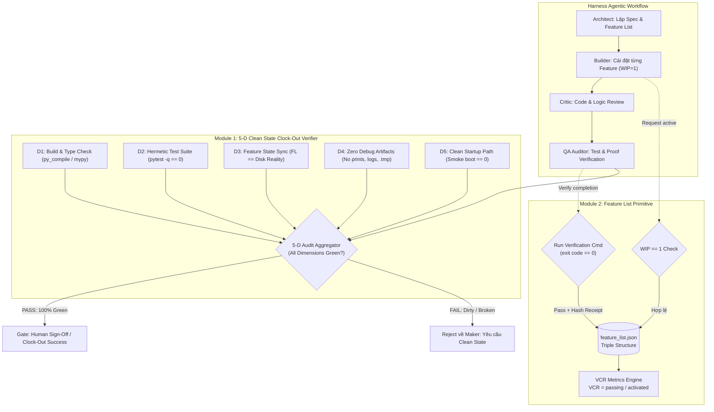
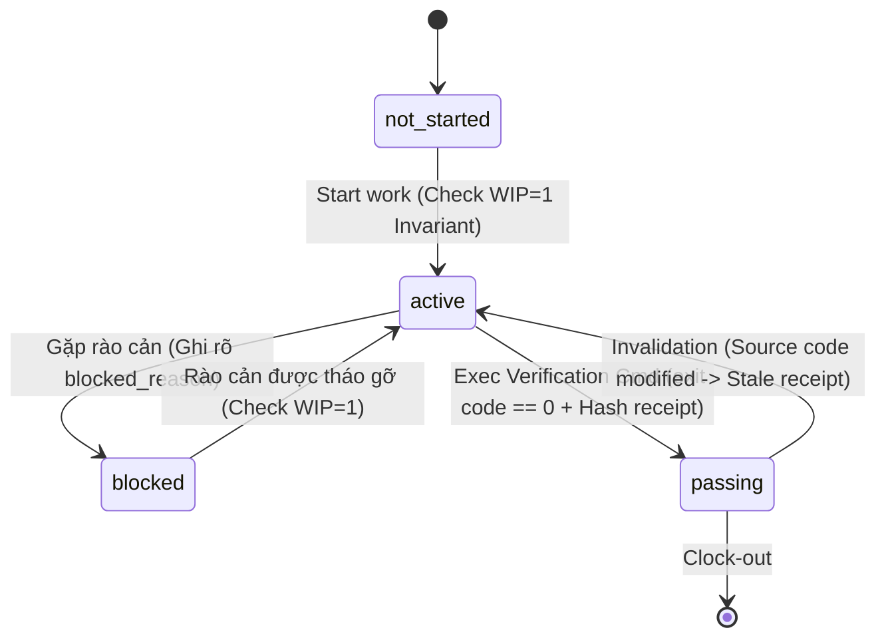

# Specification: Khung Clean State Protocol & Feature List Primitive (Harness 2.0)

- **Tài liệu**: `specs/SPEC-HARNESS-CLEAN-STATE-AND-FEATURE-LIST.md`
- **Tác giả**: SubAgent Architect (Antigravity 2.0 Harness Engineering)
- **Trạng thái**: PROPOSED / CHỜ DUYỆT (Reviewer & Sếp phê duyệt)
- **Phiên bản kiến trúc**: 2.1.0-alpha
- **Ngày ban hành**: 2026-10-26
- **Cơ sở lý luận & Nguồn tham chiếu**: Bài học thực chứng từ `learn-harness-engineering`, nguyên lý Harness Engineering trên Antigravity 2.0, quy chuẩn Dynamic Triad (GEMINI.md).

---

## 1. Phạm Vi Triển Khai (Scope)

### 1.1. Bối Cảnh & Vấn Đề Kỹ Thuật (Problem Statement)
Qua các thực nghiệm vận hành tác tử và kiểm toán phiên làm việc (`diagnosing-harness`, `learn-harness-engineering`), hai lỗ hổng kiến trúc (GAP) lớn nhất khiến vòng lặp AI tự trị bị suy thoái chất lượng bao gồm:
1. **Clock-Out Blindness & Dirty State Drift**: Tác tử sau khi tuyên bố hoàn thành task thường để lại các cặn bẩn trong không gian làm việc: file rác `.tmp`, lệnh debug chèn bừa bãi (`console.log`, `print("DEBUG...")`, `breakpoint()`), test suite âm thầm bị gãy ở các module ngoại vi, hoặc hệ thống mất khả năng khởi động sạch (Clean Startup Path). Việc thiếu một quy trình "Clock-Out 5 Chiều" tất định dẫn đến tình trạng "Local chạy lướt thì tưởng xong, nhưng commit lên là sập".
2. **Feature Sprawl & Fake Passing (Hallucinated Completion)**: Tác tử thường dàn trải mở nhiều tính năng cùng lúc (vi phạm nguyên lý Work-In-Progress WIP=1), hoặc tự ý chuyển trạng thái tính năng sang "DONE / passing" trong prompt mà không có bằng chứng lệnh kiểm thử thực tế độc lập (`exit code == 0`). Không có cấu trúc dữ liệu máy đọc được (Machine-Readable Primitive) để chốt chặn và đo lường chỉ số hoàn thành thực chất **VCR (Verified Completion Rate)**.

### 1.2. Mục Tiêu Dự Án (Objectives)
- **Module 1 - Clean State Protocol & Verifier (5-Dimension Clock-Out)**: Thiết lập bộ kiểm toán tất định (Idempotent Verifier) kiểm tra nghiêm ngặt 5 chiều chất lượng (D1 Build/Type, D2 Test Suite Hermetic, D3 Feature State Sync, D4 Zero Debug Artifacts, D5 Clean Startup Path) trước khi tác tử được phép kết thúc phiên hoặc commit mã nguồn.
- **Module 2 - Feature List Machine-Readable Primitive & WIP=1 Enforcement**: Chuẩn hóa cấu trúc `feature_list.json` với Triple Structure (Behavior Description, Verification Command, Current State & Evidence); xây dựng Validator ép luật cứng WIP=1 và triệt tiêu Fake Passing thông qua kiểm chứng hash biên bản thực thi (Execution Receipt).

### 1.3. Ranh Giới Phạm Vi (Boundaries)
- **In-Scope**:
  - Triển khai core validator: `harness/validators/clean_state_verifier.py` (5-D Clock-Out).
  - Triển khai feature list engine: `harness/validators/feature_list_validator.py`.
  - Cung cấp script công cụ độc lập: `tools/clean-state-check.ps1` và runner python: `scripts/clean_state_check.py`.
  - Mở rộng CLI `run_harness.py` tích hợp các cờ `--clean-state-check`, `--feature-list`, `--vcr-audit`.
  - Tích hợp chốt chặn Clean State vào `harness/app_workflow.py` (tại stage AUDIT và SIGN_OFF).
  - Bộ unit tests & integration tests chuyên biệt kiểm chứng 100% các điều kiện biên và rào chắn.
- **Out-of-Scope**:
  - Không thay đổi các thuật toán đánh giá Opik hoặc NLP rules hiện có trong `harness/validators/deterministic_rules.py`.
  - Không thay đổi định dạng workflow của nhánh Marketing (`harness/marketing_workflow.py`).
  - Không can thiệp sửa đổi các repo code người dùng bên ngoài workspace hiện tại.

---

## 2. Kiến Trúc & Thiết Kế (Architecture & Design)

### 2.1. Kiến Trúc Tổng Thể (System Architecture)

Khung harness được nâng cấp bổ sung hai trụ cột bảo vệ nằm ở tầng **Linter/AST Hard Constraints** và **Execution Gatekeeper**:



### 2.2. Chi Tiết Module 1: Clean State Protocol & Verifier (5 Chiều Clock-Out)

Bộ kiểm toán `CleanStateVerifier` vận hành theo cơ chế độc lập, tất định (idempotent), không gây tác dụng phụ (side-effect free):

1. **Chiều D1 - Build & Syntax / Type Integrity**:
   - Sử dụng `py_compile` quét toàn bộ tệp Python trong dự án để phát hiện lỗi cú pháp sớm.
   - Nếu dự án có cấu hình TypeScript/Node (`tsconfig.json` / `package.json`), kích hoạt kiểm tra type hoặc syntax tương ứng.
   - Bắt buộc: 100% tệp không có cú pháp lỗi.
2. **Chiều D2 - Test Suite Hermetic Green**:
   - Tự động phát hiện và thực thi test runner mặc định của repo (`pytest -q` cho Python, `vitest run` / `npm test` cho Node/TS).
   - Bắt buộc: Toàn bộ test suite vượt qua với `exit code == 0`, không có `failed` hay `error`.
3. **Chiều D3 - Feature List & State Synchronization**:
   - Đối soát chéo giữa tệp `feature_list.json` và cấu trúc mã nguồn thực tế trên đĩa.
   - Kiểm tra tính xác thực của các feature mang nhãn `passing`: Bắt buộc phải có `completion_evidence` đi kèm hash lệnh và mã nguồn khớp với trạng thái HEAD.
   - Ngăn chặn tình trạng Ghost Passing (đánh dấu passing trên giấy nhưng test không tồn tại hoặc bị sửa đổi).
4. **Chiều D4 - Zero Debug Artifacts & Stray Residue**:
   - Quét AST và biểu thức quy chuẩn (Regex) trên toàn bộ tệp mã nguồn thay đổi để phát hiện cặn bã debug:
     + Python: `print("DEBUG`, `breakpoint()`, `import pdb; pdb.set_trace()`.
     + JavaScript/TypeScript: `console.log(`, `debugger;`.
     + Rác tệp tin: Tệp `.tmp`, `.bak`, `.swp`, tệp log rác trong thư mục dự án (loại trừ `.git`, `.brain`, `node_modules`, `.pytest_cache`).
   - Cho phép bypass ngoại lệ thông qua cmt chú thích tường minh `# noqa: debug-artifact` hoặc cấu hình whitelist các module logger/CLI chuẩn.
5. **Chiều D5 - Clean Startup / Boot Path**:
   - Chạy lệnh khởi động thử nghiệm (Smoke Boot Test) trong tiến trình độc lập cách ly với timeout ngặt nghèo (mặc định 5000ms):
     + Ví dụ: `python run_harness.py --help` hoặc healthcheck entrypoint của ứng dụng.
   - Đảm bảo hệ thống có thể boot từ đầu mà không gặp crash, import vòng (circular imports) hay thiếu biến môi trường cốt lõi.

### 2.3. Chi Tiết Module 2: Feature List Machine-Readable Primitive & WIP=1

Quy trình quản lý tính năng chuyển từ dạng checklist text tự do sang một cấu trúc trạng thái máy đọc được (FSM):



- **Quy tắc Bất Biến 1 (WIP=1 Invariant)**:
  $$\sum_{f \in \text{Features}} [\text{state}(f) == \text{'active'}] \le 1$$
  Nếu một tác tử cố gắng chuyển một feature sang `active` trong khi đã có một feature khác đang `active`, Validator sẽ kích hoạt lỗi `WIPViolationError` và từ chối cập nhật trạng thái. Tác tử buộc phải chuyển feature hiện tại sang `passing` (nếu đã xong) hoặc `blocked` (nếu kẹt) trước khi nhận việc mới.
- **Quy tắc Bất Biến 2 (Strict Execution Verification Gate)**:
  Trạng thái `passing` chỉ được chấp nhận khi và chỉ khi:
  $$\text{Verify}(f) \implies \text{Run}(f.\text{verification\_command}) \to \text{exit\_code} == 0$$
  Biên bản kiểm tra (`completion_evidence`) sẽ lưu vết:
  - `command`: Lệnh chính xác đã chạy.
  - `exit_code`: Mã thoát (bắt buộc = 0).
  - `output_sha256`: Hash của stdout + stderr.
  - `manifest_sha256`: Hash snapshot của các tệp mã nguồn liên quan tại thời điểm kiểm tra.
  - `timestamp`: Thời điểm kiểm tra chuẩn ISO 8601 UTC.
- **Thước Đo Hoàn Thành Thực Chất (Verified Completion Rate - VCR)**:
  $$VCR = \frac{N_{\text{passing}}}{N_{\text{passing}} + N_{\text{active}} + N_{\text{blocked}}}$$
  Chỉ số VCR phản ánh tỷ lệ phần trăm các công việc đã thực sự được kiểm chứng độc lập trên tổng số công việc đã được kích hoạt. Tác tử không thể "thổi phồng" tiến độ bằng cách tạo ra danh sách dài rồi tick bừa.

---

## 3. Hợp Đồng & Lược Đồ Dữ Liệu (Contracts & Schemas)

### 3.1. JSON Schema Chuẩn Của `feature_list.json`

Tệp `feature_list.json` được đặt tại thư mục gốc của task hoặc dự án (`specs/feature_list.json` hoặc `.brain/<task_id>/feature_list.json`):

```json
{
  "$schema": "https://json-schema.org/draft/2020-12/schema",
  "title": "HarnessFeatureList",
  "type": "object",
  "required": ["schema_version", "project_id", "last_updated", "vcr_metrics", "features"],
  "properties": {
    "schema_version": {
      "type": "string",
      "enum": ["2.0.0"]
    },
    "project_id": {
      "type": "string",
      "minLength": 1
    },
    "last_updated": {
      "type": "string",
      "format": "date-time"
    },
    "vcr_metrics": {
      "type": "object",
      "required": ["total_features", "not_started", "active", "blocked", "passing", "vcr_score"],
      "properties": {
        "total_features": { "type": "integer", "minimum": 0 },
        "not_started": { "type": "integer", "minimum": 0 },
        "active": { "type": "integer", "minimum": 0, "maximum": 1 },
        "blocked": { "type": "integer", "minimum": 0 },
        "passing": { "type": "integer", "minimum": 0 },
        "vcr_score": { "type": "number", "minimum": 0.0, "maximum": 1.0 }
      }
    },
    "features": {
      "type": "array",
      "items": {
        "type": "object",
        "required": ["id", "category", "behavior_description", "verification_command", "state"],
        "properties": {
          "id": {
            "type": "string",
            "pattern": "^FEAT-[0-9]{3,}$"
          },
          "category": {
            "type": "string",
            "enum": ["core", "ui", "api", "sec", "harness", "perf"]
          },
          "behavior_description": {
            "type": "string",
            "minLength": 10,
            "description": "Mô tả hành vi cụ thể (Given/When/Then hoặc input -> output rõ ràng)"
          },
          "verification_command": {
            "type": "string",
            "minLength": 3,
            "description": "Lệnh thực thi độc lập trả về exit code 0 để chứng minh hành vi đạt chuẩn"
          },
          "state": {
            "type": "string",
            "enum": ["not_started", "active", "blocked", "passing"]
          },
          "blocked_reason": {
            "type": ["string", "null"]
          },
          "completion_evidence": {
            "type": ["object", "null"],
            "required": ["executed_command", "exit_code", "output_sha256", "manifest_sha256", "verified_at", "verified_by"],
            "properties": {
              "executed_command": { "type": "string" },
              "exit_code": { "type": "integer", "enum": [0] },
              "output_sha256": { "type": "string", "pattern": "^[a-f0-9]{64}$" },
              "manifest_sha256": { "type": "string", "pattern": "^[a-f0-9]{64}$" },
              "verified_at": { "type": "string", "format": "date-time" },
              "verified_by": { "type": "string" }
            }
          }
        }
      }
    }
  }
}
```

### 3.2. Data Contracts Cho Clean State Verifier (Python Dataclasses)

```python
from dataclasses import dataclass, field
from datetime import datetime
from enum import Enum
from typing import Any, Dict, List, Optional


class AuditDimension(str, Enum):
    D1_BUILD_TYPE = "D1_BUILD_TYPE"
    D2_TEST_SUITE = "D2_TEST_SUITE"
    D3_FEATURE_SYNC = "D3_FEATURE_SYNC"
    D4_ZERO_DEBUG = "D4_ZERO_DEBUG"
    D5_CLEAN_STARTUP = "D5_CLEAN_STARTUP"


class DimensionStatus(str, Enum):
    PASS = "PASS"
    FAIL = "FAIL"
    SKIPPED = "SKIPPED"


@dataclass
class DebugArtifactViolation:
    file_path: str
    line_number: int
    violation_type: str  # e.g., 'print_debug', 'console_log', 'breakpoint', 'temp_file'
    snippet: str


@dataclass
class DimensionResult:
    dimension: AuditDimension
    status: DimensionStatus
    duration_ms: float
    message: str
    details: Dict[str, Any] = field(default_factory=dict)
    violations: List[str] = field(default_factory=list)


@dataclass
class CleanStateAuditReport:
    project_root: str
    timestamp: str
    overall_status: DimensionStatus
    vcr_score: Optional[float]
    dimensions: Dict[str, DimensionResult]
    total_duration_ms: float
    is_ready_for_clockout: bool
```

### 3.3. Giao Diện Lệnh (CLI & Script Interfaces)

1. **PowerShell Fast Runner (`tools/clean-state-check.ps1`)**:
   ```powershell
   # Chạy toàn bộ 5 chiều kiểm toán
   .\tools\clean-state-check.ps1

   # Chạy chế độ ngặt nghèo (strict: dừng ngay khi 1 chiều fail)
   .\tools\clean-state-check.ps1 -Strict

   # Xuất kết quả dạng JSON cho agent tiêu hoá
   .\tools\clean-state-check.ps1 -Json -OutputFile reports\clean-state.json
   ```

2. **Python CLI Runner (`run_harness.py`)**:
   ```bash
   # Kiểm toán Clean State 5 chiều
   python run_harness.py --clean-state-check

   # Kiểm toán và xác minh Feature List
   python run_harness.py --feature-list specs/feature_list.json --vcr-audit

   # Thực thi verify một feature cụ thể và tự động cập nhật evidence
   python run_harness.py --verify-feature FEAT-001 --actor "QA_Auditor"
   ```

---

## 4. Tiêu Chí Nghiệm Thu (Acceptance Criteria có ID Rõ Ràng)

### 4.1. Tiêu Chí Clean State Protocol (Nhóm AC-CS)

- **`AC-CS-01` (D1 Build/Syntax Check)**:
  - Khi có bất kỳ tệp `.py` nào trong workspace chứa lỗi cú pháp (`SyntaxError`), chiều D1 trả về `FAIL`, liệt kê chính xác đường dẫn tệp và số dòng lỗi.
  - Khi 100% tệp Python compile sạch không lỗi, chiều D1 trả về `PASS`.
- **`AC-CS-02` (D2 Test Suite Hermetic Execution)**:
  - Hệ thống tự động kích hoạt test runner thích hợp (`pytest -q` cho Python).
  - Chiều D2 chỉ trả về `PASS` khi và chỉ khi tiến trình test kết thúc với `exit code == 0`.
  - Bất kỳ fail hoặc error nào đều làm D2 chuyển `FAIL` kèm bản trích xuất stdout/stderr lỗi.
- **`AC-CS-03` (D3 Feature List Synchronization)**:
  - Verifier đối soát `feature_list.json` với thực tế mã nguồn:
    + Nếu có feature mang trạng thái `passing` nhưng không có `completion_evidence` hợp lệ: Trả `FAIL`.
    + Nếu hash mã nguồn hiện tại không khớp với `manifest_sha256` trong evidence: Đánh dấu `STALE` và trả `FAIL`.
    + Nếu không có feature nào vi phạm: Trả `PASS`.
- **`AC-CS-04` (D4 Zero Debug Artifacts & Residue Detection)**:
  - Phát hiện thành công các mẫu cặn debug: `print("DEBUG`, `console.log(`, `breakpoint()`, `debugger;` trong các tệp mã nguồn thay đổi (ngoại trừ tệp cấu hình test hoặc tệp có nhãn `# noqa: debug-artifact`).
  - Quét và phát hiện các tệp rác còn sót lại: `*.tmp`, `*.bak`, `*.swp`, `scratch_*.py` trong thư mục dự án.
  - Chiều D4 chỉ trả về `PASS` khi số lượng vi phạm bằng 0.
- **`AC-CS-05` (D5 Clean Boot Smoke Test)**:
  - Thực thi lệnh boot mặc định (`python run_harness.py --help` hoặc lệnh cấu hình trong `harness_config.json`) trong subshell độc lập.
  - Chiều D5 chỉ trả về `PASS` nếu lệnh chạy hoàn tất không ngoại lệ với `exit code == 0` trong thời gian $\le 5000\text{ ms}$.
- **`AC-CS-06` (Idempotent Verifier Execution)**:
  - Việc chạy Verifier liên tiếp $N$ lần ($N \ge 3$) không làm thay đổi nội dung file mã nguồn, không tạo tệp rác mới ngoài báo cáo chỉ định (tính bất biến / side-effect free).

### 4.2. Tiêu Chí Feature List Primitive & WIP=1 (Nhóm AC-FL)

- **`AC-FL-01` (Triple Structure Schema Validation)**:
  - Tệp `feature_list.json` được kiểm tra tính hợp lệ qua JSON Schema Validator. Bất kỳ sự thiếu hụt trường bắt buộc nào (`behavior_description`, `verification_command`, `state`) đều bị từ chối ngay lập tức.
- **`AC-FL-02` (WIP=1 Hard Constraint)**:
  - Validator từ chối (ném ngoại lệ `WIPViolationError`) mọi thao tác chuyển trạng thái tính năng sang `active` nếu đã có một tính năng khác đang ở trạng thái `active`.
  - Hệ thống cho phép tối đa 1 tính năng `active` tại một thời điểm.
- **`AC-FL-03` (Anti-Fake-Passing Execution Gate)**:
  - Cấm tuyệt đối việc cập nhật trạng thái tính năng sang `passing` bằng cách sửa JSON thủ công.
  - Trạng thái `passing` chỉ được cấp phép khi `verification_command` của tính năng đó được runner thực thi trực tiếp và trả về `exit code == 0`.
  - Biên bản `completion_evidence` phải được ghi đầy đủ các trường hash SHA256 và timestamp.
- **`AC-FL-04` (VCR Metric Real-Time Computation)**:
  - Sau mỗi thao tác cập nhật trạng thái feature, trường `vcr_metrics` trong header của `feature_list.json` được tự động tính toán lại chính xác:
    $$VCR = \frac{\text{passing}}{\text{passing} + \text{active} + \text{blocked}}$$
    (Nếu mẫu số = 0, VCR = 1.0).
- **`AC-FL-05` (Blocked State Handling)**:
  - Khi một tính năng chuyển sang trạng thái `blocked`, bắt buộc phải có nội dung giải trình trong trường `blocked_reason` (tối thiểu 10 ký tự).
  - Khi chuyển từ `blocked` sang `active`, trường `blocked_reason` được xóa hoặc giữ lịch sử theo cấu trúc rõ ràng.

### 4.3. Tiêu Chí Tích Hợp Harness & Workflows (Nhóm AC-INT)

- **`AC-INT-01` (Harness App Workflow Gatekeeper)**:
  - Tại bước `AUDIT` và `SIGN_OFF` trong `harness/app_workflow.py`, hệ thống tự động gọi `CleanStateVerifier.audit()`.
  - Nếu `overall_status != PASS`, trạng thái task không được phép chuyển sang `APPROVED` mà bị buộc trả về `REJECTED` (yêu cầu Maker dọn dẹp và sửa lỗi).
- **`AC-INT-02` (Fast Developer Tooling)**:
  - Script `tools/clean-state-check.ps1` có thể chạy độc lập từ console PowerShell với tốc độ phản hồi nhanh, in ra bảng trạng thái 5 chiều trực quan với màu sắc (Xanh / Đỏ) và mã thoát tương ứng (0 khi đỗ, 1 khi trượt).
- **`AC-INT-03` (Unit & Regression Test Coverage)**:
  - Toàn bộ module `clean_state_verifier.py` và `feature_list_validator.py` phải có bộ test riêng biệt tại `tests/test_clean_state_verifier.py` và `tests/test_feature_list_validator.py`.
  - Toàn bộ test suite mới cùng 100% test suite cũ của repo phải vượt qua xanh hoàn toàn (`pytest tests/ -q` exit code == 0).

---

## 5. Rủi Ro & Biện Pháp Giảm Thiểu (Risks & Mitigations)

| STT | Rủi Ro Nhận Diện (Risk) | Mức Độ | Biện Pháp Giảm Thiểu (Mitigation) |
| :--- | :--- | :---: | :--- |
| **R1** | **Flaky Tests làm gãy chiều D2 trong Clean State**: Một số test tích hợp hoặc test có phụ thuộc thời gian/mạng có thể chập chờn, khiến D2 bị FAIL oan. | Cao | Thiết lập cơ chế chạy thử nghiệm cách ly (hermetic), hỗ trợ chỉ định phạm vi test nhanh thông qua file cấu hình; cho phép gắn cờ retry (tối đa 1 lần) đối với các test đánh dấu `@pytest.mark.flaky_tolerated`. |
| **R2** | **False Positives ở chiều D4 (Debug Artifacts)**: Mã nguồn CLI hoặc Logging nghiệp vụ hợp lệ chứa các câu lệnh `print()` hoặc `console.log()` bị nhận nhầm là rác debug. | Trung bình | Sử dụng AST parser thay vì Regex thuần túy. Hỗ trợ cơ chế whitelist thông qua comment inline `# noqa: debug-artifact` hoặc cấu hình thư mục ngoại lệ (`cli/`, `logging/`, `scripts/`). |
| **R3** | **Quá tải thời gian (Latency Overhead) khi repo lớn**: Chạy toàn bộ 5 chiều kiểm toán trước mỗi commit có thể làm chậm nhịp độ làm việc của tác tử. | Trung bình | Tối ưu hóa: D1 và D4 chỉ kiểm tra các tệp có thay đổi theo Git status (`git diff --name-only`); D2 cho phép chạy fast-test suite trước, chỉ chạy full suite ở phase Clock-Out cuối cùng. |
| **R4** | **Xung đột File Locking & Mã hóa đường dẫn trên Windows**: Quá trình quét tệp và chạy test subshell trên Windows có thể bị vướng `PermissionDenied` hoặc lỗi UTF-8 console. | Cao | Áp dụng triệt để `pathlib.Path`, mở file với context manager `encoding="utf-8"`, và sử dụng helper `safe_task_runner` hoặc `reconfigure(encoding="utf-8")` đã chuẩn hóa trong harness. |
| **R5** | **Agent cố tình bypass lệnh Verification bằng cách mock lệnh ảo**: Agent có thể khai báo một `verification_command` tầm thường (như `echo ok`) để lấy exit code 0. | Cao | Khung Validator kiểm tra tính xác thực của `verification_command`: Lệnh phải tham chiếu đến tệp test thực tế hoặc script kiểm thử có trong repo (`pytest tests/...`, `node test/...`), cấm các lệnh rỗng như `exit 0` hay `echo`. |

---

## 6. Lộ Trình Triển Khai Đề Xuất (Implementation Phases)

1. **Pha 1 (Contracts & Models)**: Tạo cấu trúc dữ liệu, dataclasses, exception types và JSON schemas cho Feature List & Clean State.
2. **Pha 2 (Core Engines)**:
   - Viết `harness/validators/feature_list_validator.py` (WIP=1, FSM transitions, VCR calc, command runner).
   - Viết `harness/validators/clean_state_verifier.py` (5 chiều D1-D5).
3. **Pha 3 (Tooling & Integration)**:
   - Viết script `tools/clean-state-check.ps1` và `scripts/clean_state_check.py`.
   - Mở rộng CLI `run_harness.py` tích hợp các cờ mới.
   - Gắn chốt chặn kiểm tra vào `harness/app_workflow.py`.
4. **Pha 4 (Verification & Audit)**:
   - Viết full test suite (`test_clean_state_verifier.py`, `test_feature_list_validator.py`).
   - Rerun toàn bộ test suite repo đảm bảo không có bất kỳ regression nào.
